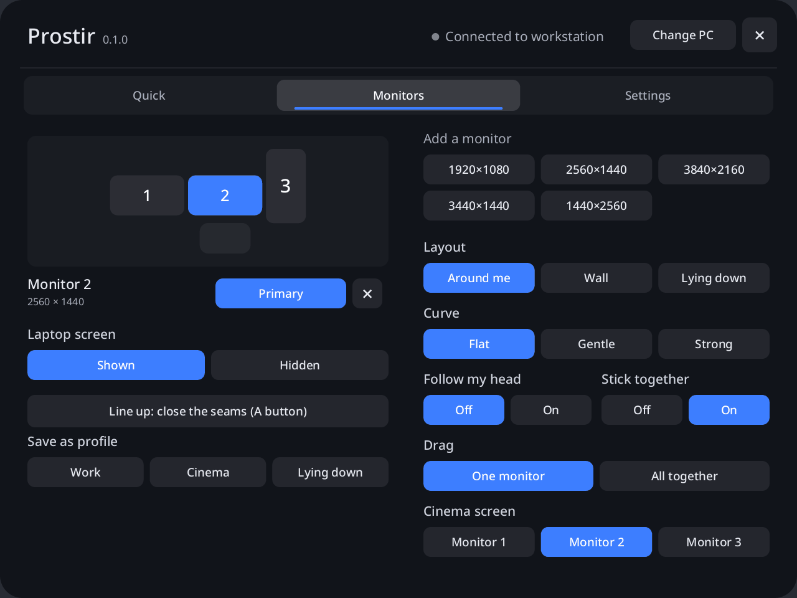
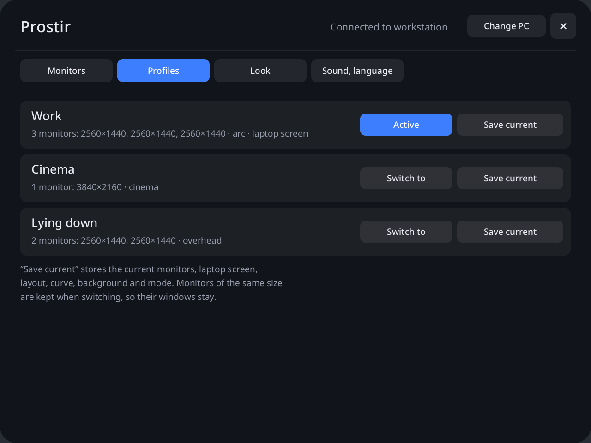
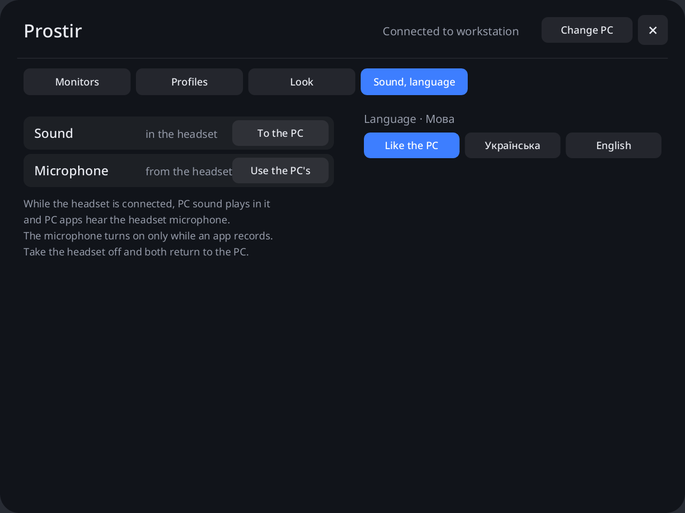
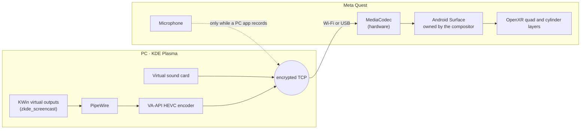

<p align="center">
  
</p>

<h1 align="center">Prostir</h1>

<p align="center">
  Extra KDE Plasma monitors around you in a Meta Quest 3.
</p>

<p align="center">
  <a href="https://github.com/OlexiyOdarchuk/prostir/actions/workflows/ci.yml"></a>
  <a href="https://github.com/OlexiyOdarchuk/prostir/releases"></a>
  <a href="LICENSE"></a>
  
  
</p>

<p align="center">
  <a href="README.uk.md">Українською</a> ·
  <a href="#what-it-does">What it does</a> ·
  <a href="#install">Install</a> ·
  <a href="#use">Use</a> ·
  <a href="#security">Security</a>
</p>

---

Prostir (Ukrainian for "space") puts extra monitors for your KDE Plasma laptop or
desktop into a Quest headset. They are real KWin outputs, not pictures of windows:
they show up in System Settings → Display, you can drag and maximize windows onto
them, the Plasma panel can live there, and the mouse moves from one screen to the
next where they meet in front of you.

I wrote it because I wanted three big monitors on a laptop without carrying them
around. I use it every day on KDE Plasma 6.8 (Wayland) with Intel Arc graphics and a
Quest 3. It is version 0.1, so expect rough edges, and please open an issue when you
hit one.

<p align="center">
  
</p>
<p align="center"><sub>A capture from the headset: the right monitor shows KDE's display settings with the three Prostir outputs.</sub></p>

<table>
  <tr>
    <td></td>
    <td></td>
  </tr>
  <tr>
    <td></td>
    <td></td>
  </tr>
</table>

<p align="center"><sub>The menu in the headset (rendered on the PC with <code>--example panel_preview</code>).</sub></p>

## What it does

You add, remove and reorder monitors from inside the headset: 1080p, 1440p, 4K,
ultrawide or portrait, up to six. KDE rearranges its displays to match the order you
see, so the mouse always leaves one screen where the next one begins. The monitor in
the middle is the primary one and gets the Plasma panel.

Text stays sharp because the video goes straight into the Quest compositor's own
layers (`XR_KHR_android_surface_swapchain`) instead of a flat window inside an app.
The PC encodes with the GPU's video engine (VA-API HEVC on Intel or AMD) and the Quest
decodes in hardware. Over Wi-Fi a frame takes about 14 ms from the encoder to the
display on my setup.

Monitors can sit on an arc, in a grid, in a column, or above your head for lying down.
They can be flat or curved, and on an arc they touch edge to edge, so three of them
read as one wide screen. The laptop's own screen can hang below the main monitor
without a seam, so you can see it without taking the headset off. It disappears when
you close the lid.

Profiles switch the whole setup at once. Out of the box there is "Work" (three 1440p
monitors and the laptop screen), "Cinema" (one 4K screen, big and far away, the rest
hidden) and "Lying down" (two monitors overhead). Save your own setup into any of them.
Monitors that are the same size in both profiles stay, so their windows do not move.
In cinema mode you pick which monitor becomes the big screen.

Focus mode dims every monitor except the one with the mouse.

PC sound plays in the headset, and the headset microphone becomes the PC's microphone.
The headset only records while some app on the PC is actually listening.

When you take the headset off, the PC stops encoding right away. After 10 seconds it
removes the virtual monitors, so windows, the panel, sound and microphone go back to
the laptop. Put the headset back on and everything comes back.

The background can be black, your room through the passthrough cameras, one of four
built-in panoramas, or a photo of your own. Your hands can be shown (handy over a
keyboard) and, if you want, used for pointing: pinch to click, pinch and hold to drag.
With your hands in view, the menu opens within arm's reach and works like a
touchscreen. A keyboard window can show your real desk through a rectangle you place
over the keyboard, on any background.

The headset and the PC speak Ukrainian or English. The headset follows the PC's
language unless you pick one in the menu.

Connection works over Wi-Fi (the headset finds the PC by itself) or a USB cable.
Everything is encrypted, and a PC streams nothing to a headset it has not been paired
with.

<p align="center">
  
</p>

## Requirements

**PC**

- KDE Plasma 6 on Wayland. KWin provides the virtual outputs.
- PipeWire with `pw-cli` and `pw-loopback`, and GStreamer 1.22 or newer with the `va`
  plugin (gst-plugins-bad) plus the PipeWire and PulseAudio plugins.
- A GPU with a VA-API HEVC or H.264 encoder (Intel, AMD). Without one, start with
  `--software` to encode with x264 on the CPU.
- `kscreen-doctor`, which comes with Plasma. Optional: `qdbus6` for matching
  wallpapers, `adb` for USB, `kdialog` or `zenity` for the pairing dialog.

| Distribution | Packages |
|---|---|
| Arch | `gstreamer gst-plugins-good gst-plugins-bad gst-plugin-pipewire` + `intel-media-driver` (Intel) or `libva-mesa-driver` (AMD) |
| Fedora | `gstreamer1 gstreamer1-plugins-good gstreamer1-plugins-bad-free pipewire-gstreamer` + VA driver |
| Debian/Ubuntu | `gstreamer1.0-plugins-good gstreamer1.0-plugins-bad gstreamer1.0-pipewire` + VA driver |

**Headset**

- Meta Quest 3 or 3S. Quest 2 and Pro should work, but I have not tried them.
- Developer mode, to install the app with `adb`. Turn it on in the Meta Horizon phone
  app: Devices → Headset settings → Developer mode.

## Install

### From a release

1. Download `prostir-<version>-x86_64-linux.tar.gz` and `prostir-<version>.apk` from
   [Releases](../../releases).
2. On the PC:
   ```sh
   tar xf prostir-*-x86_64-linux.tar.gz && cd prostir-*/
   ./install.sh             # installs into ~/.local without root; --autostart starts it with Plasma
   ```
3. On the headset, connected with a USB cable:
   ```sh
   adb install prostir-*.apk
   ```

### From source

```sh
# PC
cargo build --release -p prostir-host
./scripts/install.sh

# Quest: needs the Android SDK with the NDK and build-tools, and the Rust target
rustup target add aarch64-linux-android
./scripts/build-apk.sh --install   # builds build/prostir.apk and installs it with adb
```

## Use

1. Start Prostir on the PC from the application menu, or run `prostir`. Its icon
   appears in the system tray.
2. On the headset, open Prostir from Library → Unknown sources.
3. The headset looks for the PC on the USB cable first, then on Wi-Fi. If it finds
   several PCs, pick one in the menu, or type the IP address on the keypad.
4. The first time, pair them. The headset shows a 6-digit code; type it into the dialog
   that opens on the PC. The button under the code swaps the sides, if you would rather
   type the PC's code in the headset.
5. The monitors appear in front of you. Press A to line them up.

If the connection drops, the monitors wait 30 seconds in KDE (`--linger`) for the
headset to come back before the windows move back to the laptop.

### Controls

| | Controller | Hands (menu → Look → Hands → Show and use) |
|---|---|---|
| Open the menu | ☰ or X on the left controller, or the round ☰ button under the main monitor | pinch the ☰ button |
| Press a button in the menu | trigger | touch it with a finger, or pinch from afar |
| Move the menu | hold grip and point | touch an empty spot with a finger and drag |
| Click on a monitor | trigger | pinch |
| Move a monitor or the menu | hold grip and point | pinch and hold for about 0.3 s |
| Nearer or farther | thumbstick up or down while holding | move your hand away or closer |
| Bigger or smaller | thumbstick left or right while holding | |
| Line the monitors up | A | menu → Monitors → Layout |
| Recenter | hold the Meta button | system gesture |

With hands in view, the menu opens within arm's reach so you can touch it. A dot shows
where your finger is; pull the finger back to press the next button.

### Menu

**Monitors.** Add a monitor (1920×1080, 2560×1440, 3840×2160, 3440×1440 or
1440×2560), remove one, make one primary, move it left or right in the row, and show
or hide the laptop screen. Below that: layout, curve, and the desk or cinema mode.

**Profiles.** Switch to a profile, or save the current setup into it.

**Look.** Background, hands and focus mode. For your own background, copy an
equirectangular `background.jpg` or `background.png` to
`/sdcard/Android/data/dev.prostir.client/files/` on the headset.

**Sound, language.** Where PC sound plays, which microphone the PC uses, and the
interface language.

### Tray on the PC

The tray shows whether the headset is connected and how many monitors there are. From
it you can set the video quality (15, 30 or 50 Mbit/s per monitor, applied right away),
turn on sharper text (a slower encoder preset: clearer small text at the same bitrate
for about 2 ms more per frame), start Prostir with the session, forget paired headsets,
and quit.

### Command line

```
prostir [--monitor WxH[@scale]]... [--codec h265|h264] [--bitrate MBPS] [--software]
        [--keep-primary] [--linger SECONDS] [--port PORT] [--no-discovery] [--no-adb]
```

Without `--monitor`, Prostir brings back the monitors from the last session. They are
stored in `~/.config/prostir/monitors.txt`.

## Limitations

- KDE Plasma 6 on Wayland only. The virtual monitors come from KWin's screencast
  protocol, so GNOME, other compositors and X11 sessions are not supported.
- Hardware encoding needs VA-API, which means Intel or AMD graphics. NVIDIA cards do not
  offer VA-API encoding; `--software` works there, but encodes on the CPU.
- Tested on Quest 3. Quest 3S should behave the same; Quest 2 and Pro are untested.
- Not in the Meta Horizon Store: you install it in developer mode with `adb`, and the
  Quest lists it under Unknown sources by its package name, `dev.prostir.client`.
- One headset per PC at a time.

## Performance and battery

Numbers from my laptop with three 2560×1440 monitors and the laptop screen in the
headset:

- The PC uses about 2 % of one CPU core and 250 MB of RAM. The GPU's video engine does
  the encoding, and only when a screen changes.
- On the network, each monitor uses up to the chosen bitrate while its picture changes
  and almost nothing while it is still. Sound adds 1.5 Mbit/s.
- On the headset, every monitor needs one hardware decoder (idle while the picture is
  still) and one compositor layer per frame. Fewer or smaller monitors, the black
  background and hidden hands save the most battery. The room background keeps the
  passthrough cameras on.

## Security

Every connection starts with a Noise `XX` handshake (Curve25519, ChaCha20-Poly1305,
BLAKE2s). After it, the picture, sound and microphone are encrypted and authenticated.

A headset and a PC pair once. Until then, the PC creates no monitors and sends
nothing. The 6-digit code goes through SPAKE2, so someone who records the traffic
cannot guess it offline, and the confirmation is tied to that connection's handshake,
which stops a man in the middle.

The PC keeps the keys of paired headsets in `~/.config/prostir/paired_headsets`; the
tray item "Forget paired headsets" clears it. The headset keeps its keys inside the app.

Ports: TCP 47830 for the stream and UDP 47831 for discovery. The discovery broadcast
contains only the PC's host name.

## Troubleshooting

- Headset log: `adb logcat -s prostir`.
- PC log: run `prostir` in a terminal. `RUST_LOG=debug prostir` adds the GStreamer
  pipeline and encoder timings.
- The headset does not find the PC over Wi-Fi: both must be on the same network, and
  the network must not isolate clients (guest networks often do). Type the PC's IP on
  the keypad or use a cable.
- A capture on the Quest comes out black: some capture modes leave out the compositor
  layers Prostir draws with. Switch the capture format in the Quest camera settings.

## How it works



The code is split into three Rust crates:

```
proto/    the wire protocol and encryption, a library used by the other two
host/     the PC program: virtual outputs, encoders, sound, tray, discovery
client/   the Quest app: OpenXR loop (app.rs), menu (ui.rs), layouts (layout.rs), …
scripts/  build-apk.sh, install.sh, package-release.sh
docs/     pictures for this README
```

Besides streaming, the PC side arranges the outputs in KDE with `kscreen-doctor`,
copies the wallpaper to every monitor through Plasma's scripting API, mirrors the
laptop screen with `stream_output`, and asks KWin which output has the mouse for focus
mode. The Quest app is native OpenXR written in Rust; the compositor draws the
monitors, and the app itself renders only the hands.

`cargo test` runs the protocol, layout, profile and menu tests on the PC.
`cargo run -p prostir-host --bin prostir-probe -- [HOST:PORT] [SECONDS] [DIR]` connects
like a headset, pairs, and saves the video and sound it receives, to check the PC side
without a headset.
`cargo run -p prostir-client --example panel_preview -- menu.png` renders the headset
menu to a PNG (`TAB=profiles|look|sound`, `LANG_UI=en`), and
`--example sky_preview -- DIR` renders the panoramas.

## Similar projects

- [qwayland](https://github.com/jboero/qwayland): the same idea with 2D Horizon OS
  panels and NVIDIA encoding.
- [WiVRn](https://github.com/WiVRn/WiVRn) with [wlx-overlay-s](https://github.com/galister/wlx-overlay-s):
  general OpenXR streaming with desktop overlays.
- [Breezy Desktop](https://github.com/wheaney/breezy-desktop): virtual displays for AR
  glasses on KDE and GNOME.
- Immersed: proprietary, runs on several platforms.

## License

[GPL-3.0-or-later](LICENSE). The bundled Noto Sans font is under the
[SIL Open Font License 1.1](client/assets/OFL-NotoSans.txt).

Meta and Meta Quest are trademarks of Meta Platforms, Inc. KDE and Plasma are
trademarks of KDE e.V. Prostir is an independent project and is not affiliated with
or endorsed by either.
