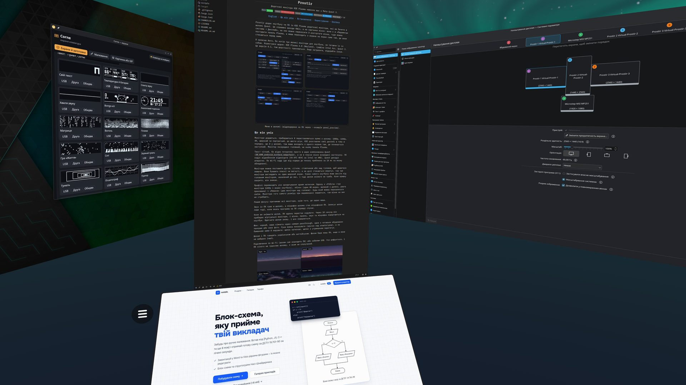
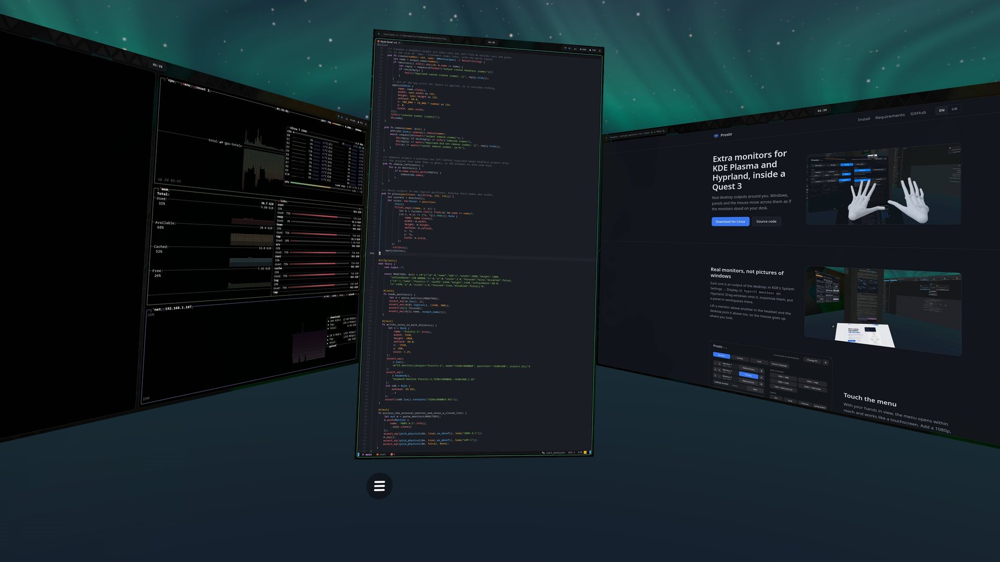
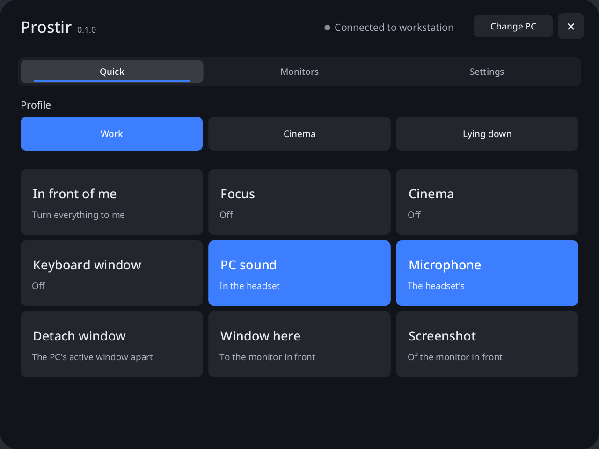
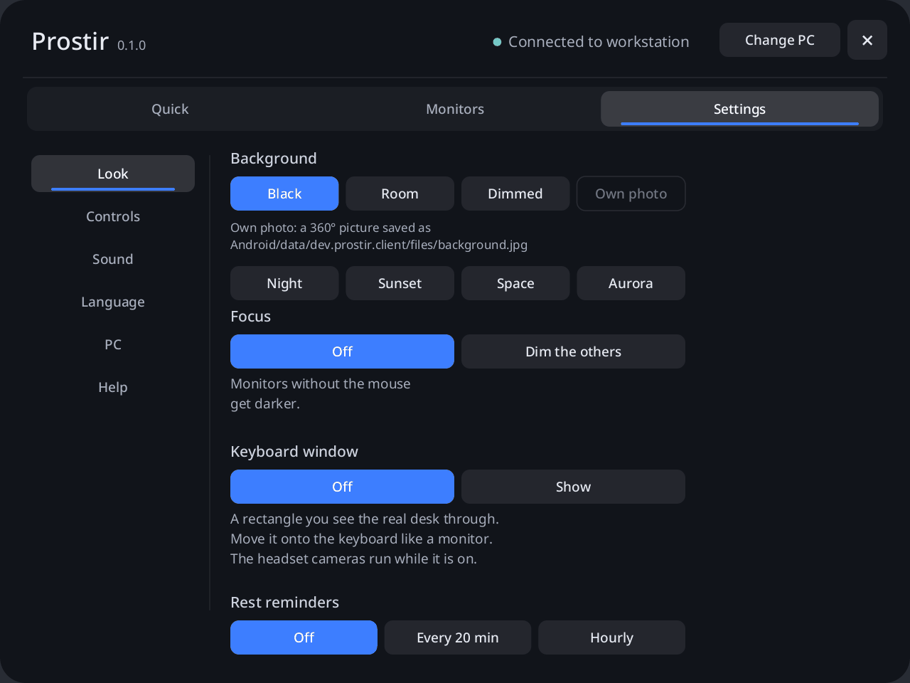
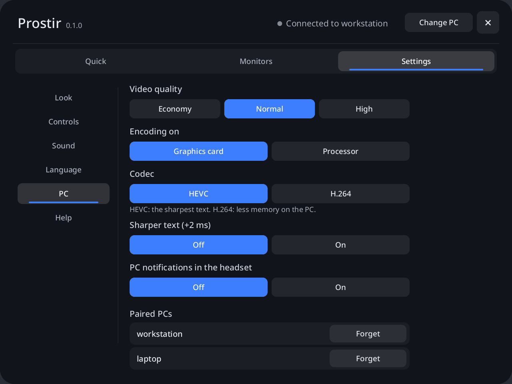
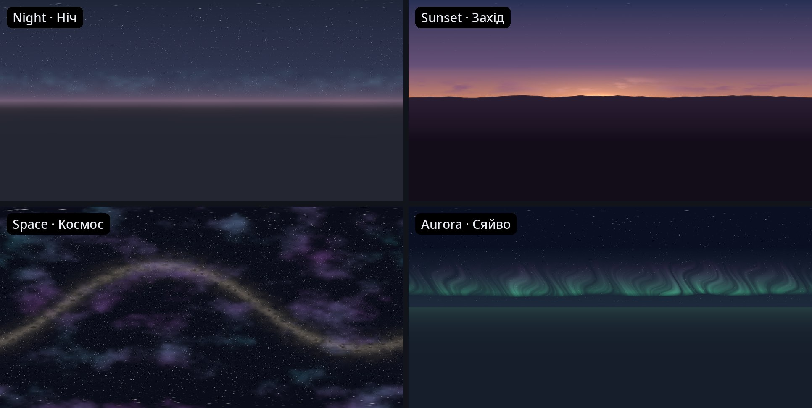
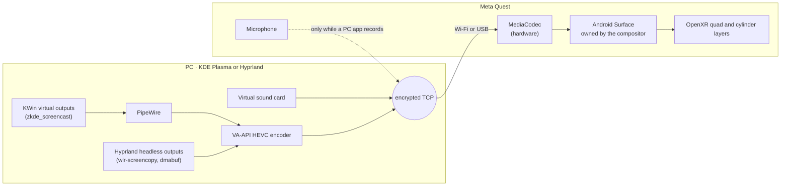

<p align="center">
  
</p>

<h1 align="center">Prostir</h1>

<p align="center">
  Extra monitors for KDE Plasma and Hyprland around you in a Meta Quest 3.
</p>

<p align="center">
  <a href="https://github.com/OlexiyOdarchuk/prostir/actions/workflows/ci.yml"></a>
  <a href="https://github.com/OlexiyOdarchuk/prostir/releases"></a>
  <a href="LICENSE"></a>
  
  
</p>

<p align="center">
  <a href="README.uk.md">Українською</a> ·
  <a href="#what-it-does">What it does</a> ·
  <a href="#install">Install</a> ·
  <a href="#use">Use</a> ·
  <a href="#troubleshooting-and-faq">FAQ</a> ·
  <a href="#security">Security</a>
</p>

---

Prostir (Ukrainian for "space") puts extra monitors for your KDE Plasma or Hyprland
laptop or desktop into a Quest headset. They are real outputs of the compositor, not
pictures of windows: in KDE they show up in System Settings → Display, in Hyprland in
`hyprctl monitors`. You can drag and maximize windows onto them, keep a panel or
workspaces there, and the mouse moves from one screen to the next where they meet in
front of you.

I wrote it because I wanted three big monitors on a laptop without carrying them
around. I use it every day on KDE Plasma 6.8 and Hyprland 0.57 with Intel Arc graphics
and a Quest 3. It is version 0.1, so expect rough edges, and please open an issue when you
hit one.

<p align="center">
  
</p>
<p align="center"><sub>A capture from the headset: the right monitor shows KDE's display settings with the three Prostir outputs.</sub></p>

<p align="center">
  
</p>
<p align="center"><sub>The same on Hyprland: each Prostir monitor gets its own Waybar and workspaces.</sub></p>

<table>
  <tr>
    <td></td>
    <td></td>
  </tr>
  <tr>
    <td></td>
    <td></td>
  </tr>
</table>

<p align="center"><sub>The menu in the headset (rendered on the PC with <code>--example panel_preview</code>).</sub></p>

## What it does

You add, remove and reorder monitors from inside the headset: 1080p, 1440p, 4K,
ultrawide or portrait, up to six. The desktop rearranges its displays to match the
order you see, so the mouse always leaves one screen where the next one begins. In KDE
the monitor in the middle is the primary one and gets the Plasma panel.

Text stays sharp because the video goes straight into the Quest compositor's own
layers (`XR_KHR_android_surface_swapchain`) instead of a flat window inside an app.
The PC encodes with the GPU's video engine (VA-API HEVC on Intel or AMD) and the Quest
decodes in hardware. On my setup, an encoded frame takes about 14 ms over Wi-Fi to
reach the headset display (network, decoding and showing it). That is not the whole
delay from screen to eye: capturing and encoding the screen add a few milliseconds
before it.

Monitors can sit on an arc, in a grid, in a column, or above your head for lying down.
They can be flat or curved, and on an arc they touch edge to edge, so three of them
read as one wide screen. The laptop's own screen can hang below the main monitor
without a seam, so you can see it without taking the headset off. It disappears when
you close the lid.

Profiles switch the whole setup at once. Out of the box there is "Work" (three 1440p
monitors and the laptop screen), "Cinema" (one 4K screen, big and far away, the rest
hidden) and "Lying down" (two monitors overhead). Save your own setup into any of them (Monitors → Save as profile).
Monitors that are the same size in both profiles stay, so their windows do not move.
In cinema mode you pick which monitor becomes the big screen.

Focus mode dims every monitor except the one with the mouse.

PC sound plays in the headset, and the headset microphone becomes the PC's microphone.
The headset only records while some app on the PC is actually listening, and only
while the microphone switch in the headset menu (Quick, or Settings → Sound) is on. The PC can
ask for the microphone, but the switch in the headset decides.

When you take the headset off, the PC stops encoding right away. After 10 seconds it
removes the virtual monitors, so windows, the panel, sound and microphone go back to
the laptop. Put the headset back on and everything comes back.

The background can be black, your room through the passthrough cameras, one of four
built-in panoramas, or a photo of your own. Your hands can be shown (handy over a
keyboard) and, if you want, used for pointing: pinch to click, pinch and hold to drag.
With your hands in view, the menu opens within arm's reach and works like a
touchscreen. A keyboard window can show your real desk through a rectangle you place
over the keyboard, on any background.

A single window can also leave the desktop: "Detach window" gives the PC's active
window an output of its own, its size, and the headset shows it as a floating panel
without a frame, closer to you than the monitors. Up to three, since the headset has
only so many video decoders. Close the window and the panel goes. "Window here" moves
the active window to the monitor in front of you, and a screenshot of that monitor
lands in `~/Pictures/Prostir`.

The arrangement can follow your head: turn or move away and, once you have clearly
looked elsewhere, the monitors glide after you. On Hyprland the mouse can follow your
gaze, jumping to the monitor you look at, and "Where is the mouse?" shows it with
rings.

Turn your left palm to your face and a small menu appears by the wrist: bring
everything in front of you, focus, cinema, where is the mouse, screenshot, the main
menu. The PC's notifications can show in the headset, and reminders can ask you to
rest your eyes every 20 minutes or take a break every hour. All of these are off
until you turn them on.

The headset and the PC speak Ukrainian or English. The headset follows the PC's
language unless you pick one in the menu.

Connection works over Wi-Fi (the headset finds the PC by itself) or, in developer
mode, a USB cable. Everything is encrypted, and a PC streams nothing to a headset it
has not been paired with.

<p align="center">
  
</p>

## Requirements

**PC**

- KDE Plasma 6 on Wayland, or Hyprland (tested with 0.57, Lua and `hyprland.conf`
  configs both work). KWin streams its virtual outputs itself; on Hyprland Prostir
  creates headless outputs and captures them with `wlr-screencopy` straight into GPU
  buffers.
- PipeWire with its PulseAudio server (`pipewire-pulse`), `pw-cli`, `pw-loopback` and
  `pactl`.
- GStreamer 1.22 or newer with the `va` plugin (hardware encoding), `h264parse` and
  `h265parse`, and the PipeWire and PulseAudio plugins.
- For hardware encoding, a GPU with a VA-API H.265 or H.264 encoder (Intel, AMD) and
  its VA driver. Without one, Prostir encodes on the CPU with x264, which needs the
  `x264enc` plugin from gst-plugins-ugly. See [NVIDIA and CPU encoding](#nvidia-and-cpu-encoding).
- On KDE, `kscreen-doctor`, which comes with Plasma. Optional: `qdbus6` for matching
  wallpapers, `adb` for USB, and one of `kdialog`, `zenity`, `fuzzel`, `wofi` or `rofi`
  for the pairing dialog. Screenshots use `spectacle` on KDE and `grim` on Hyprland.
- On Hyprland, a bar with a tray (Waybar with the `tray` module) for the menu, and a
  notification daemon (mako, dunst, swaync) for messages. See [Hyprland](#hyprland).

Prostir's own packages (see [Install](#install)) pull all of this in. For the tarball,
install these first:

| Distribution | Packages |
|---|---|
| Arch | `gstreamer gst-plugins-base gst-plugins-good gst-plugins-bad-libs gst-plugin-va gst-plugin-pipewire pipewire-audio pipewire-pulse libpulse`, plus `intel-media-driver` on Intel (the AMD driver comes with `mesa`). CPU encoding: `gst-plugins-ugly` |
| Fedora | `gstreamer1-plugins-base gstreamer1-plugins-good gstreamer1-plugins-bad-free pipewire-gstreamer pipewire-utils pipewire-pulseaudio pulseaudio-utils`, plus a VA driver with H.264/H.265 encoding (see below). CPU encoding: `gstreamer1-plugins-ugly` from RPM Fusion |
| Debian 13, Ubuntu 25.04 or newer | `gstreamer1.0-plugins-base gstreamer1.0-plugins-good gstreamer1.0-plugins-bad gstreamer1.0-pipewire pipewire-bin pipewire-pulse pulseaudio-utils`, plus `mesa-va-drivers` (AMD) or `intel-media-va-driver-non-free` (Intel). CPU encoding: `gstreamer1.0-plugins-ugly` |

Debian 12 and Ubuntu 24.04 ship Plasma 5, which Prostir does not support.

**Fedora and openSUSE.** Their Mesa is built without H.264 and H.265 encoding, so AMD
graphics have no hardware encoder out of the box. On Fedora, enable
[RPM Fusion](https://rpmfusion.org/Configuration) and run
`sudo dnf swap mesa-va-drivers mesa-va-drivers-freeworld`. On Intel, `intel-media-driver`
from RPM Fusion nonfree supports more encoders than Fedora's `libva-intel-media-driver`. On openSUSE, the Packman build of Mesa
(`Mesa-libva`) has the encoders. `vainfo` lists `VAEntrypointEncSlice` for H.264 or
HEVC when encoding works. Without it, Prostir falls back to the CPU.

**Headset**

- Meta Quest 3 or 3S. Quest 2 and Pro should work, but I have not tried them.
- Developer mode, to install the app with `adb`. Turn it on in the Meta Horizon phone
  app: Devices → Headset settings → Developer mode.

### NVIDIA and CPU encoding

When no VA-API encoder works (NVIDIA cards, a missing `gst-plugin-va` or VA driver,
Fedora or openSUSE Mesa without the codecs), Prostir switches to CPU encoding with x264
by itself. That needs `x264enc` (gst-plugins-ugly) and costs CPU time and some latency,
so fewer or smaller monitors help. If neither works, the headset says what is missing
instead of retrying. `--software` forces CPU encoding even when a GPU encoder exists.

## Install

### With a package manager

Each [release](../../releases) has packages for the PC part. They install
`/usr/bin/prostir` and pull in the dependencies above.

```sh
yay -S prostir-bin                                  # Arch (AUR)
sudo apt install ./prostir_<version>-1_amd64.deb    # Debian, Ubuntu
sudo dnf install ./prostir-<version>-1.x86_64.rpm   # Fedora
```

The `.rpm` is built for Fedora. On openSUSE and other distributions, use the tarball.

### From a release tarball

1. Download `prostir-<version>-x86_64-linux.tar.gz`, `prostir-<version>.apk` and
   `SHA256SUMS` from [Releases](../../releases), and check them with
   `sha256sum -c --ignore-missing SHA256SUMS`.
2. On the PC:
   ```sh
   tar xf prostir-*-x86_64-linux.tar.gz && cd prostir-*/
   ./install.sh             # installs into ~/.local without root
   ./install.sh --autostart # the same, and starts Prostir when you log in (KDE)
   ```
   The script warns when `~/.local/bin` is not on your `PATH` and, on Hyprland, prints
   the lines to add to your config.

### On the headset

With developer mode on and the headset connected with a USB cable:

```sh
adb install prostir-*.apk
```

### Firewall

The PC listens on TCP port 47830 and announces itself with UDP broadcasts on port
47831. If a firewall runs on the PC, allow both:

```sh
sudo ufw allow 47830/tcp && sudo ufw allow 47831/udp            # ufw (Ubuntu)
sudo firewall-cmd --add-port=47830/tcp --add-port=47831/udp --permanent \
  && sudo firewall-cmd --reload                                 # firewalld (Fedora, openSUSE)
```

### Hyprland

- **Tray and messages.** Prostir's menu lives in the tray, so you need a bar with a
  tray, such as Waybar with the `tray` module. Messages (pairing, updates, the usage
  counter) need a notification daemon such as mako, dunst or swaync.
- **Autostart.** Hyprland without uwsm ignores the XDG autostart folder, so add Prostir
  to your config. Use the full path for a tarball install, because `~/.local/bin` is
  often not on Hyprland's `PATH`:
  ```lua
  -- hyprland.lua
  hl.on("hyprland.start", function () hl.exec_cmd("~/.local/bin/prostir") end)
  ```
  ```ini
  # hyprland.conf
  exec-once = ~/.local/bin/prostir   # or just "prostir" for a package install
  ```
- **Permissions.** With `ecosystem:enforce_permissions` on, allow Prostir to capture
  the screen:
  `hl.permission("/usr/(local/)?bin/prostir|.*/\\.local/bin/prostir", "screencopy", "allow")`
  in `hyprland.lua`, or `permission = /usr/(local/)?bin/prostir|.*/\.local/bin/prostir, screencopy, allow`
  in `hyprland.conf`.
- **Pairing dialog.** Prostir asks for the pairing code with `kdialog` or `zenity`, or
  with `fuzzel`, `wofi` or `rofi` in dmenu mode. Install one of them.

### From source

```sh
# PC
cargo build --release -p prostir-host
./scripts/install.sh

# Quest: needs the Android SDK with the NDK and build-tools, and the Rust target
rustup target add aarch64-linux-android
./scripts/build-apk.sh --install   # builds build/prostir.apk and installs it with adb
```

## Use

1. Start Prostir on the PC from the application menu, or run `prostir`. Its icon
   appears in the system tray. The first time, a notification explains the usage
   counter and how to turn it off (see [Security](#security)).
2. On the headset, open Prostir from Library → Unknown sources.
3. The headset tries the USB cable first (developer mode only), then Wi-Fi. If it
   finds several PCs, pick yours, or type the PC's IP address on the keypad.
4. The first time, the headset asks "Pair with <PC name>?". Confirm, and the headset
   shows a 6-digit code; type it into the small dialog that opens on the PC. If you
   would rather do it the other way round, the button under the code shows the code
   on the PC (in the tray and a notification), and you type it in the headset.
5. The monitors appear in front of you. Press A to line them up.

If the connection drops, the monitors wait 30 seconds in KDE (`--linger`) for the
headset to come back before the windows move back to the laptop.

### Wi-Fi or USB

Wi-Fi works for everyone: the PC and the headset only need to be on the same network,
and the network must let devices talk to each other. A USB cable is the other way. It
helps on networks that keep devices apart (hotels, offices, some mesh routers), keeps
the Wi-Fi free and gives the steadiest picture. It needs developer mode on the headset
and `adb` on the PC. Installs from the Meta Horizon Store, once Prostir is there, will
use Wi-Fi only.

### Connect with a USB cable

1. Turn on developer mode for the headset: in the Meta Horizon app on your phone, open
   Devices → your headset → Headset settings → Developer mode.
2. Install `adb` on the PC: `sudo pacman -S android-tools` (Arch),
   `sudo apt install adb` (Debian, Ubuntu) or `sudo dnf install android-tools`
   (Fedora).
3. Connect the headset to the PC with a USB-C cable that carries data (not a
   charge-only one). A USB 3 port is best; USB 2 is enough for three monitors at the
   normal quality.
4. Put the headset on. It asks "Allow USB debugging?": tick "Always allow from this
   computer" and allow.
5. Check that `adb devices` lists the headset as `device`. If it says `unauthorized`,
   unplug, plug in again and answer the question in the headset.
6. Start Prostir on the PC (or leave it running). Every few seconds it looks for
   headsets on USB and runs `adb reverse tcp:47830 tcp:47830` for each, so the headset
   reaches the PC at 127.0.0.1.
7. Open Prostir in the headset. It tries the cable before Wi-Fi, and the menu says
   "Connected to PC (USB)". Pairing is the same as over Wi-Fi, once per PC.

Unplug the cable and the headset goes back to Wi-Fi by itself. `prostir --no-adb`
stops the PC from touching `adb`. A laptop port usually charges the headset slower
than it drains while you work, so for long sessions keep it charged beforehand or use
a powered hub.

### Controls

| | Controller | Hands (menu → Settings → Controls → Hands → Show and use) |
|---|---|---|
| Open the menu | ☰ or X on the left controller, or the round ☰ button under the main monitor | the system menu gesture (pinch with the left palm towards you), or "Menu" on the wrist menu |
| Wrist menu | | turn the left palm to your face; press with the right index finger |
| Press a button in the menu | trigger | touch it with a finger, or pinch from afar |
| Click on a monitor | trigger | pinch |
| Move a monitor | point at it, then press the trigger on the bar that appears under it, or hold grip anywhere on it | pinch the bar under it, or pinch and hold anywhere on it for about 0.3 s |
| Move the menu | hold grip and point | touch an empty spot with a finger and drag |
| Nearer or farther | thumbstick up or down while holding | move your hand away or closer |
| Bigger or smaller | thumbstick left or right while holding, or hold it with both controllers and move them apart or together | hold it with both hands and move them apart or together |
| Line the monitors up | A | menu → Monitors → Layout |
| Bring everything in front of you | menu → Quick → In front of me | same, or the wrist menu |

With hands in view, the menu opens within arm's reach so you can touch it. A light
shows where your finger is about to touch; pull the finger back to press the next
button. Left-handed? Settings → Controls → Wrist menu → Right wrist puts the wrist menu
on the right hand, pressed with the left.

### Menu

**Quick** opens first: the three profiles (Work, Cinema, Lying down) and big tiles for
what you switch every day. In front of me, focus, cinema, the keyboard window, PC
sound, microphone, detach window, window here and screenshot. What is on is lit.

**Monitors.** Add a monitor (1920×1080, 2560×1440, 3840×2160, 3440×1440 or
1440×2560), remove one, make one primary, move it left or right in the row, and show
or hide the laptop screen. Each one is labelled with where it stands (left, middle,
right, above, below). Detached windows are listed too, with a button to close them.
Then the layout (around me, wall, lying down), the curve, desk or cinema mode, follow
my head, the cinema screen, and "Save as profile".

**Settings**, in parts:

- **Look**: background (black, the room, the room dimmed, a panorama or your own
  photo), focus mode, the keyboard window, rest reminders. For your own background,
  copy an equirectangular `background.jpg` or `background.png` to
  `/sdcard/Android/data/dev.prostir.client/files/` on the headset.
- **Controls**: hands, mouse follows the gaze (where the PC allows it), menu size,
  which wrist has the wrist menu, and the headset display rate (90 Hz, or 72 Hz to
  save battery: the video is 60 frames a second either way).
- **Sound**: where PC sound plays and which microphone the PC uses.
- **Language**: like the PC, Ukrainian or English.
- **PC**: video quality (15, 30 or 50 Mbit/s per monitor), encoding on the graphics
  card or the processor, HEVC or H.264, sharper text, the PC's notifications in the
  headset, and the PCs this headset is paired with, each of which you can forget.
  The PC applies quality and sharper text at once; another codec restarts the encoders
  in a second, and the monitors and windows stay. The PC remembers these choices.
- **Help**: the controls, the version, and the first-run tips again.

### Tray on the PC

The tray shows whether the headset is connected, how many monitors there are and the
headset's battery; when it drops to 15 % the PC shows a notification. From the tray
you can bring the monitors in front of you, set the video quality and sharper text
(the same settings as in the headset menu), start Prostir with the session (KDE), turn
the usage counter on or off, forget paired headsets, and quit.

### Command line

```
prostir [--monitor WxH[@scale]]... [--codec h265|h264] [--bitrate MBPS] [--software]
        [--keep-primary] [--linger SECONDS] [--port PORT] [--no-discovery] [--no-adb]
```

Without `--monitor`, Prostir brings back the monitors from the last session. They are
stored in `~/.config/prostir/monitors.txt`, together with the choices from the headset
menu's PC settings. `--codec` and `--software` on the command line win over those.

## Update and uninstall

**Update.** Install the new version the same way as the old one: your package manager
(`yay -Syu`, `sudo apt install ./prostir_<version>-1_amd64.deb`,
`sudo dnf upgrade ./prostir-<version>-1.x86_64.rpm`), or `./install.sh` from the new
tarball. On the headset, `adb install -r prostir-<version>.apk` keeps the settings and
the pairing. Settings and paired headsets on the PC stay in `~/.config/prostir`.

Update both sides when you can. Small differences in version do not break the
connection; when the two are too far apart, the headset says which side to update.

**Uninstall.**

- Tarball install: `./install.sh --uninstall` removes the program, its menu entry,
  icon and autostart entry. `./install.sh --uninstall --purge` also removes the
  settings and paired headsets in `~/.config/prostir`.
- Packages: `sudo pacman -R prostir-bin`, `sudo apt remove prostir` or
  `sudo dnf remove prostir`. Packages do not touch your home folder; remove
  `~/.config/prostir` and `~/.config/autostart/prostir.desktop` yourself if you want.
- Hyprland: remove the lines you added to your config.
- Headset: `adb uninstall dev.prostir.client`, or uninstall it from the Library. This
  also deletes its settings and pairing keys.

## Limitations

- KDE Plasma 6 and Hyprland on Wayland. GNOME is not supported yet: if you want it,
  add a 👍 to [issue #1](https://github.com/OlexiyOdarchuk/prostir/issues/1). X11 sessions are not supported.
- Hyprland has no primary monitor, so "Make primary" there only picks the monitor the
  headset puts in front of you.
- Hardware encoding needs VA-API, which means Intel or AMD graphics. NVIDIA cards do not
  offer VA-API encoding, so Prostir encodes on the CPU there, which costs CPU time and
  some latency.
- Tested on Quest 3. Quest 3S should behave the same; Quest 2 and Pro are untested.
- Not in the Meta Horizon Store yet: you install it in developer mode with `adb`, and
  the Quest lists it under Unknown sources by its package name, `dev.prostir.client`.
- One headset per PC at a time.

## Performance and battery

Numbers from my laptop (Intel graphics) with three 2560×1440 monitors and the laptop
screen in the headset:

- The PC uses about 2 % of one CPU core. Memory depends on the codec, because Intel's
  driver reserves a lot for each HEVC encoder: about 340 MB with HEVC, about 120 MB with
  H.264 (Settings → PC → Codec). Waiting for the headset, Prostir takes about 16 MB,
  and it returns the memory after a session. CPU encoding (x264) uses much more CPU.
- On the network, each monitor uses up to the chosen bitrate while its picture changes
  and almost nothing while it is still. Sound adds 1.5 Mbit/s.
- On the headset, the app itself uses about 40 % of one CPU core while streaming
  (decryption runs on the ARMv8 crypto instructions). Every monitor needs one hardware
  decoder (idle while the picture is still) and one compositor layer per frame.
  Fewer or smaller monitors, the black background, hidden hands and the 72 Hz display
  rate save the most battery. The room backgrounds keep the passthrough cameras on.

## Security

Every connection starts with a Noise `XX` handshake (Curve25519, ChaCha20-Poly1305,
BLAKE2s). After it, the picture, sound and microphone are encrypted and authenticated.

A headset and a PC pair once. Until then, the PC creates no monitors and sends
nothing, and the headset does not pair with a PC on its own: it asks first. The
6-digit code goes through SPAKE2, so someone who records the traffic cannot guess it
offline, and the confirmation is tied to that connection's handshake, which stops a
man in the middle. After failed attempts the PC waits longer and longer before it
accepts the next one, so the code cannot be guessed by trying.

The PC keeps the keys of paired headsets in `~/.config/prostir/paired_headsets`; the
tray item "Forget paired headsets" clears it. The headset keeps its keys inside the app
and lists the paired PCs in Settings → PC, where you can forget any of them.

The headset sends microphone sound only while its own microphone switch is on (menu,
Quick or Settings → Sound). The PC can ask for the microphone, but cannot turn the switch on.

With "PC notifications in the headset" on, the PC reads the notifications other apps
send on the session bus and passes their app name, title and text to the headset over
the same encrypted connection. It stops reading them when you turn it off or the
headset disconnects.

Official builds count how many PCs use Prostir: once a day, when a headset connects,
the PC sends one request to GoatCounter with only the date in it (and `/install` the
first time). No identifier, host name or settings go with it. On the first start a
notification says so and how to turn it off, and the first count is sent no earlier
than the next day (UTC), so there is time to do that. Turn it off in the tray ("Count
this PC among users") or with `PROSTIR_NO_COUNT=1`; builds from source never count.
The key that official builds use for counting can be read out of the program. It can
only add counts, so the worst anyone can do with it is inflate the numbers. See the
[privacy policy](https://prostir.ishawyha.dev/privacy.html).

The discovery broadcast contains only the PC's host name. Ports are listed under
[Firewall](#firewall).

To report a security problem privately, use
[GitHub's private vulnerability reporting](https://github.com/OlexiyOdarchuk/prostir/security/advisories/new).

## Troubleshooting and FAQ

**Logs.** Headset: `adb logcat -s prostir`. PC: run `prostir` in a terminal;
`RUST_LOG=debug prostir` adds the GStreamer pipeline and encoder timings.

**The headset lists my PC, but connecting does nothing.** A firewall on the PC blocks
TCP port 47830. Allow it, see [Firewall](#firewall).

**The headset does not find the PC.** Both must be on the same network, and the
network must not isolate clients (guest networks often do). A firewall can also block
the UDP broadcast on port 47831. Type the PC's IP on the keypad, or use a cable
(developer mode).

**No picture, or the headset says an encoder is missing.** Check what GStreamer has:
`gst-inspect-1.0 vah265enc vah264enc x264enc`. Install the VA plugin and driver for your
distribution (on Arch, `gst-plugin-va`), or `gst-plugins-ugly` for CPU encoding. On
Fedora and openSUSE with AMD graphics, see the codec note under
[Requirements](#requirements).

**I have an NVIDIA card.** Prostir encodes on the CPU with x264 there, by itself. Install
gst-plugins-ugly. See [NVIDIA and CPU encoding](#nvidia-and-cpu-encoding).

**No pairing dialog opens on the PC.** Install `zenity` or `kdialog`, or have `fuzzel`,
`wofi` or `rofi` installed. Or press the button under the code in the headset to do it
the other way round: the PC shows the code in the tray and a notification, and you
type it in the headset.

**Hyprland: no tray icon, no notifications, no autostart.** See [Hyprland](#hyprland).

**`prostir: command not found` after `install.sh`.** `~/.local/bin` is not on your
`PATH`. Run `~/.local/bin/prostir`, or add the folder to `PATH` in your shell profile.

**PC sound stays on the laptop, or apps do not see the headset microphone.** Prostir
switches the default output and input with `pactl`. Install it (`libpulse` on Arch,
`pulseaudio-utils` on Debian, Ubuntu and Fedora), or pick "Prostir" in your sound
settings by hand.

**The headset says to update the PC or the headset.** The two versions are too far
apart. Install the newest release on the side it names.

**`adb install` fails with `INSTALL_FAILED_UPDATE_INCOMPATIBLE`.** The installed app was
signed with another key (for example, you built it yourself). Uninstall it first with
`adb uninstall dev.prostir.client`; this removes the headset's settings and pairing.

**Is the 14 ms the whole latency?** No. It is the time from an encoded frame to the
headset display over Wi-Fi. Capturing and encoding the screen come before that and add
a few milliseconds.

**A capture on the Quest comes out black.** Some capture modes leave out the compositor
layers Prostir draws with. Switch the capture format in the Quest camera settings.

## How it works



The code is split into three Rust crates:

```
proto/    the wire protocol and encryption, a library used by the other two
host/     the PC program: virtual outputs, encoders, sound, tray, discovery
client/   the Quest app: OpenXR loop (app.rs), menu (ui.rs), layouts (layout.rs), …
scripts/  build-apk.sh, install.sh, package-release.sh, third-party-licenses.py
docs/     pictures for this README
```

On Hyprland the same jobs go through its IPC socket: `output create headless`, monitor
rules (Lua `eval` or `keyword`) for the layout, and the focused monitor for focus mode.
Frames are captured into GPU buffers with a tiling the VA-API converter reads directly,
so nothing passes through the CPU.

Besides streaming, the PC side arranges the outputs in KDE with `kscreen-doctor`,
copies the wallpaper to every monitor through Plasma's scripting API, mirrors the
laptop screen with `stream_output`, and asks KWin which output has the mouse for focus
mode. The Quest app is native OpenXR written in Rust; the compositor draws the
monitors, and the app itself renders only the hands.

`cargo test` runs the protocol, layout, profile and menu tests on the PC.
`cargo run -p prostir-host --bin prostir-probe -- [HOST:PORT] [SECONDS] [DIR]` connects
like a headset, pairs, and saves the video and sound it receives, to check the PC side
without a headset.
`cargo run -p prostir-client --example panel_preview -- menu.png` renders the headset
menu to a PNG (`TAB=profiles|look|sound`, `LANG_UI=en`), and
`--example sky_preview -- DIR` renders the panoramas.

## Similar projects

- [qwayland](https://github.com/jboero/qwayland): the same idea with 2D Horizon OS
  panels and NVIDIA encoding.
- `krfb-virtualmonitor` (part of KDE's Krfb): adds a virtual monitor to KWin and shares
  it over VNC, so any VNC client on the Quest can show it in a flat window.
- [WiVRn](https://github.com/WiVRn/WiVRn) or [ALVR](https://github.com/alvr-org/ALVR)
  with [WayVR](https://github.com/galister/wlx-overlay-s) (formerly wlx-overlay-s):
  stream a whole OpenXR or SteamVR session from the PC, with your existing screens and
  apps as overlays in it. The right choice for VR games.
- [Breezy Desktop](https://github.com/wheaney/breezy-desktop): virtual monitors on KDE
  Plasma 6 and GNOME for XR glasses such as XREAL and VITURE, not for Quest. Open
  source; the productivity features need a license after a free trial.
- [Immersed](https://immersed.com): proprietary, on several platforms. On Linux, its
  built-in virtual monitors work on GNOME on Wayland.
- [Virtual Desktop](https://www.vrdesktop.net): proprietary; its PC streamer runs on
  Windows and macOS, not Linux.

Why another one? Prostir does one thing on Linux: new monitors that are real outputs
of KWin or Hyprland, so windows, panels and the mouse treat them like plugged-in
screens. The PC needs no VR runtime (no SteamVR or Monado), the Quest compositor draws
the monitors directly, and PC sound and the headset microphone come along. It also does
less than the projects above: no VR games, no Windows, macOS or GNOME, and one headset
per PC.

## License

[GPL-3.0-or-later](LICENSE), with an [additional permission](LICENSE-EXCEPTION.md) to
link with the Meta Platform SDK (needed only for a Horizon Store build). The bundled
Noto Sans font is under the
[SIL Open Font License 1.1](client/assets/OFL-NotoSans.txt). Every release includes
`THIRD-PARTY-LICENSES.txt` with the licenses of the Rust crates, the font and the
Khronos OpenXR loader that the release files contain. The tarball and the packages
install it next to the GPL text, and the APK carries it under `assets/licenses/`.
`scripts/third-party-licenses.py` writes it.

Meta and Meta Quest are trademarks of Meta Platforms, Inc. KDE and Plasma are
trademarks of KDE e.V. Prostir is an independent project and is not affiliated with
or endorsed by either.
