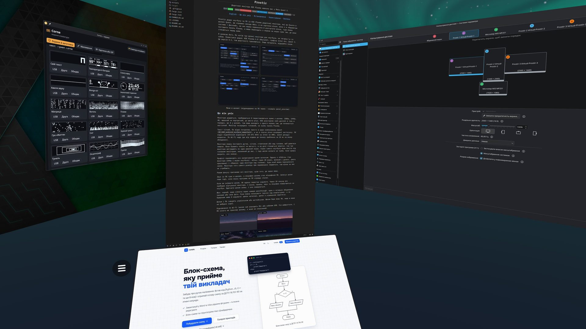
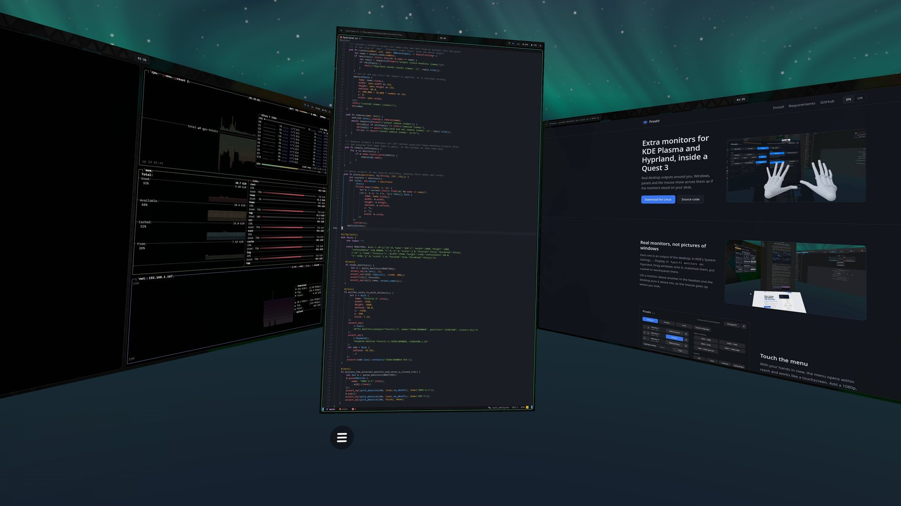
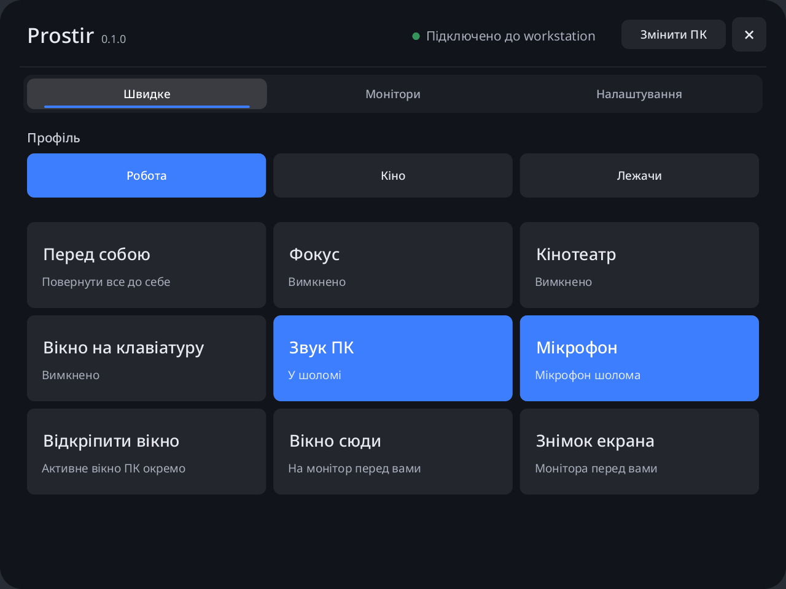
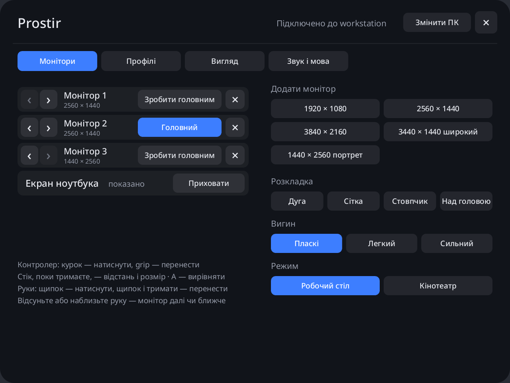
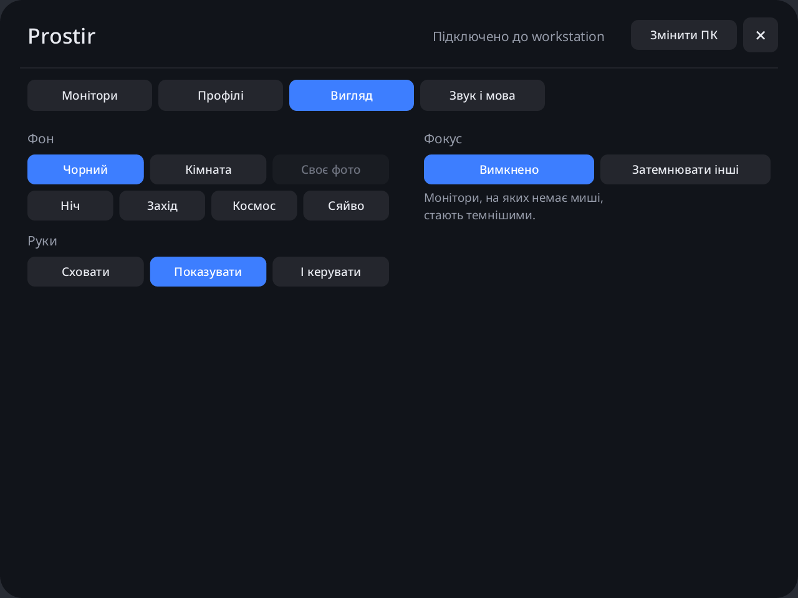
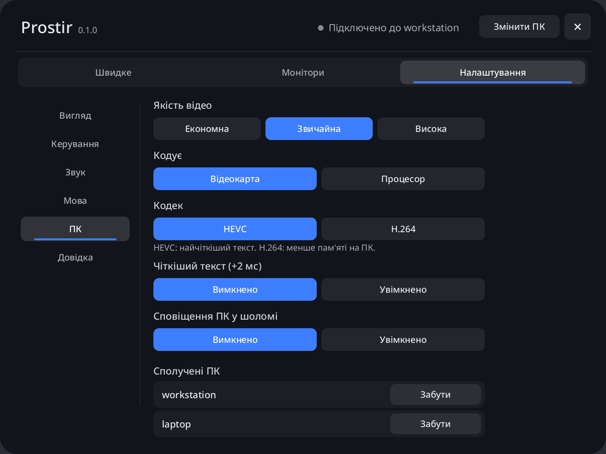
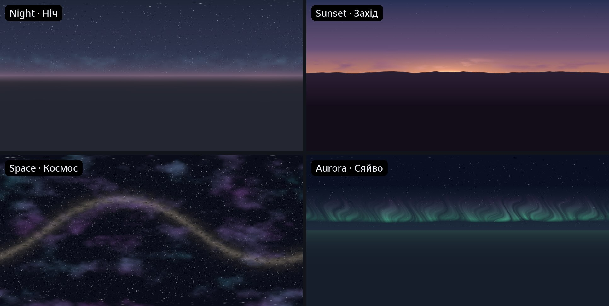
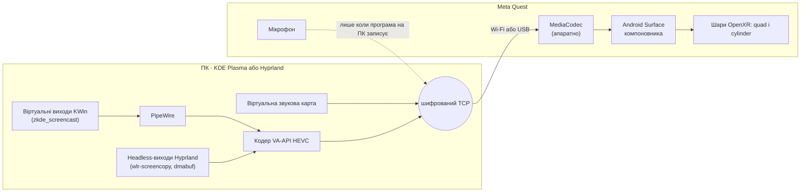

<p align="center">
  
</p>

<h1 align="center">Prostir</h1>

<p align="center">
  Додаткові монітори для KDE Plasma і Hyprland навколо вас у Meta Quest 3.
</p>

<p align="center">
  <a href="https://github.com/OlexiyOdarchuk/prostir/actions/workflows/ci.yml"></a>
  <a href="https://github.com/OlexiyOdarchuk/prostir/releases"></a>
  <a href="LICENSE"></a>
  
  
</p>

<p align="center">
  <a href="README.md">English</a> ·
  <a href="#що-він-уміє">Що він уміє</a> ·
  <a href="#встановлення">Встановлення</a> ·
  <a href="#користування">Користування</a> ·
  <a href="#якщо-щось-не-так-і-часті-питання">Питання</a> ·
  <a href="#безпека">Безпека</a>
</p>

---

Prostir додає ноутбуку чи ПК із KDE Plasma або Hyprland додаткові монітори, які ви бачите в шоломі
Quest. Це справжні виходи KWin, а не картинки вікон: вони є в «Параметри системи →
Дисплей», на них можна переносити й розгортати вікна, туди можна поставити панель
Plasma, а миша переходить з екрана на екран саме там, де вони стикаються перед вами.

Я написав його, бо хотів три великі монітори для ноутбука, не тягаючи їх із собою.
Користуюся щодня: KDE Plasma 6.8 і Hyprland 0.57, графіка Intel Arc, Quest 3. Це версія 0.1,
тож шорсткості трапляються. Якщо натрапите, відкрийте issue.

<p align="center">
  
</p>
<p align="center"><sub>Знімок із шолома: на правому моніторі параметри дисплея KDE з трьома виходами Prostir.</sub></p>

<p align="center">
  
</p>
<p align="center"><sub>Те саме в Hyprland: кожен монітор Prostir має свій Waybar і робочі столи.</sub></p>

<table>
  <tr>
    <td></td>
    <td></td>
  </tr>
  <tr>
    <td></td>
    <td></td>
  </tr>
</table>

<p align="center"><sub>Меню в шоломі (відрендерене на ПК через <code>--example panel_preview</code>).</sub></p>

## Що він уміє

Монітори додаються, прибираються й переставляються прямо з шолома: 1080p, 1440p, 4K,
широкий чи портретний, до шести штук. Робочий стіл розставляє свої дисплеї в тому ж
порядку, що й у шоломі, тож миша виходить з одного екрана там, де починається
наступний. У KDE монітор посередині головний, на ньому панель Plasma.

Текст чіткий, бо відео потрапляє просто в шари компоновника Quest
(`XR_KHR_android_surface_swapchain`), а не в пласке вікно всередині застосунку. ПК
кодує відеоблоком відеокарти (VA-API HEVC на Intel чи AMD), Quest декодує апаратно.
На моєму обладнанні закодований кадр доходить по Wi-Fi до дисплея шолома приблизно за
14 мс (мережа, декодування й показ). Це не вся затримка від екрана до ока: захоплення
й кодування екрана додають перед цим ще кілька мілісекунд.

Монітори можна поставити дугою, сіткою, стовпчиком або над головою, щоб дивитися лежачи.
Вони бувають пласкі чи вигнуті, а на дузі стикаються впритул, тож три монітори
виглядають як один широкий екран. Екран самого ноутбука може висіти під головним
монітором без шва, і тоді шолом знімати не треба. Коли кришку закрито, він зникає.

Профілі перемикають усе налаштування одним натиском. Одразу є «Робота» (три монітори
1440p і екран ноутбука), «Кіно» (один 4K-екран, великий і далеко, решта прихована) і
«Лежачи» (два монітори над головою). Будь-який можна перезаписати своїм («Монітори» →
«Зберегти як профіль»). Монітори того
самого розміру при перемиканні лишаються, тож вікна на них не стрибають.

У режимі кінотеатру можна вибрати, який монітор стане великим екраном.

Режим фокусу притемнює всі монітори, крім того, де зараз миша.

Звук із ПК грає в шоломі, а мікрофон шолома стає мікрофоном ПК. Записує шолом лише тоді,
коли якась програма на ПК справді слухає, і лише поки ввімкнено перемикач мікрофона в
меню шолома («Швидке» або «Налаштування» → «Звук»). ПК може попросити мікрофон, але
вирішує перемикач у шоломі.

Коли ви знімаєте шолом, ПК одразу перестає кодувати. Через 10 секунд він прибирає
віртуальні монітори, і вікна, панель, звук та мікрофон повертаються на ноутбук.
Вдягнете шолом знову, і все повернеться.

Фон: чорний, ваша кімната через камери passthrough, одна з чотирьох вбудованих панорам
або своє фото. Руки можна показувати (зручно над клавіатурою), а за бажанням ними й
керувати: щипок натискає, щипок з утриманням перетягує. Коли руки в полі зору, меню
відкривається на відстані витягнутої руки й працює як сенсорний екран. Вікно на
клавіатуру показує справжній стіл крізь прямокутник, який ви кладете на клавіатуру,
на будь-якому фоні.

Окреме вікно теж можна винести з робочого столу: «Відкріпити вікно» дає активному вікну
ПК власний вихід його розміру, а шолом показує його плаваючою панеллю без рамки, ближче
до вас, ніж монітори. Таких може бути до трьох, бо відеодекодерів у шолома не так
багато. «Прикріпити» під панеллю (з'являється, коли на неї
наведено) повертає вікно на монітор, звідки його відкріпили; закриєте вікно, і
панель теж зникне. «Вікно сюди» переносить активне вікно на
монітор перед вами, а знімок екрана цього монітора потрапляє в `~/Pictures/Prostir`.

Монітори можуть іти слідом за головою: коли ви відвернетеся чи відійдете й явно
дивитиметеся деінде, вони плавно попливуть слідом. У Hyprland миша може йти за
поглядом і перестрибувати на монітор, на який ви дивитеся, а «Де миша?» показує її
кільцями.

Поверніть ліву долоню до обличчя, і біля зап'ястя з'явиться маленьке меню: поставити
все перед собою, фокус, кінотеатр, де миша, знімок, головне меню. Сповіщення ПК можуть
з'являтися в шоломі, а нагадування можуть кликати дати очам відпочити кожні 20 хвилин
чи зробити перерву щогодини. Усе це вимкнено, доки ви самі не ввімкнете.

Шолом і ПК говорять українською або англійською. Шолом бере мову ПК, якщо в меню не
вибрано іншої.

Підключення по Wi-Fi (шолом сам знаходить ПК) або, в режимі розробника, кабелем USB.
Усе шифрується, і ПК нічого не транслює шолому, з яким не сполучений.

<p align="center">
  
</p>

## Вимоги

**ПК**

- KDE Plasma 6 на Wayland або Hyprland (перевірено на 0.57, працюють і конфіги Lua, і
  `hyprland.conf`). KWin транслює віртуальні виходи сам; у Hyprland Prostir створює
  headless-виходи й захоплює їх через `wlr-screencopy` просто в буфери відеокарти.
- PipeWire з його сервером PulseAudio (`pipewire-pulse`), `pw-cli`, `pw-loopback` і
  `pactl`.
- GStreamer 1.22 або новіший із плагіном `va` (апаратне кодування), `h264parse` і
  `h265parse` та плагінами PipeWire і PulseAudio.
- Для апаратного кодування відеокарта з VA-API-кодером H.265 або H.264 (Intel, AMD) і
  її драйвер VA. Без нього Prostir кодує на процесорі через x264, для цього потрібен
  плагін `x264enc` з gst-plugins-ugly. Див. [NVIDIA і кодування на процесорі](#nvidia-і-кодування-на-процесорі).
- У KDE `kscreen-doctor`, він іде з Plasma. Необов'язково: `qdbus6` для однакових
  шпалер, `adb` для USB і щось одне з `kdialog`, `zenity`, `fuzzel`, `wofi` чи `rofi` для
  віконця сполучення. Знімки екрана робить `spectacle` у KDE і `grim` у Hyprland.
- У Hyprland панель із треєм (Waybar з модулем `tray`) для меню і демон сповіщень
  (mako, dunst, swaync) для повідомлень. Див. [Hyprland](#hyprland).

Пакети Prostir (див. [Встановлення](#встановлення)) підтягують усе це самі. Для архіву
спершу поставте:

| Дистрибутив | Пакети |
|---|---|
| Arch | `gstreamer gst-plugins-base gst-plugins-good gst-plugins-bad-libs gst-plugin-va gst-plugin-pipewire pipewire-audio pipewire-pulse libpulse`, а на Intel ще `intel-media-driver` (драйвер AMD іде з `mesa`). Кодування на процесорі: `gst-plugins-ugly` |
| Fedora | `gstreamer1-plugins-base gstreamer1-plugins-good gstreamer1-plugins-bad-free pipewire-gstreamer pipewire-utils pipewire-pulseaudio pulseaudio-utils` і драйвер VA з кодуванням H.264/H.265 (див. нижче). Кодування на процесорі: `gstreamer1-plugins-ugly` з RPM Fusion |
| Debian 13, Ubuntu 25.04 чи новіші | `gstreamer1.0-plugins-base gstreamer1.0-plugins-good gstreamer1.0-plugins-bad gstreamer1.0-pipewire pipewire-bin pipewire-pulse pulseaudio-utils` і `mesa-va-drivers` (AMD) або `intel-media-va-driver-non-free` (Intel). Кодування на процесорі: `gstreamer1.0-plugins-ugly` |

Debian 12 і Ubuntu 24.04 мають Plasma 5, яку Prostir не підтримує.

**Fedora й openSUSE.** Їхня Mesa зібрана без кодування H.264 і H.265, тож графіка AMD
одразу апаратного кодера не має. У Fedora ввімкніть
[RPM Fusion](https://rpmfusion.org/Configuration) і виконайте
`sudo dnf swap mesa-va-drivers mesa-va-drivers-freeworld`. На Intel `intel-media-driver`
з RPM Fusion nonfree уміє більше кодерів, ніж `libva-intel-media-driver` із Fedora. В
openSUSE кодери має збірка Mesa з Packman (`Mesa-libva`). Коли кодування працює,
`vainfo` показує `VAEntrypointEncSlice` для H.264 або HEVC. Без нього Prostir
переходить на процесор.

**Шолом**

- Meta Quest 3 або 3S. Quest 2 і Pro мають працювати, але я їх не перевіряв.
- Режим розробника, щоб поставити застосунок через `adb`. Вмикається в застосунку Meta
  Horizon на телефоні: Пристрої → Налаштування шолома → Режим розробника.

### NVIDIA і кодування на процесорі

Коли жоден VA-API-кодер не працює (карти NVIDIA, немає `gst-plugin-va` чи драйвера VA,
Mesa у Fedora чи openSUSE без кодеків), Prostir сам переходить на кодування процесором
через x264. Для цього потрібен `x264enc` (gst-plugins-ugly), і це коштує процесорного
часу та трохи затримки, тож допомагає менше чи менших моніторів. Якщо не працює ні те,
ні те, шолом пише, чого бракує, а не пробує знову й знову. `--software` вмикає
кодування процесором, навіть коли кодер відеокарти є.

## Встановлення

### Через менеджер пакетів

Кожен [реліз](../../releases) має пакети для ПК. Вони ставлять `/usr/bin/prostir` і
підтягують залежності, перелічені вище.

```sh
yay -S prostir-bin                                  # Arch (AUR)
sudo apt install ./prostir_<версія>-1_amd64.deb     # Debian, Ubuntu
sudo dnf install ./prostir-<версія>-1.x86_64.rpm    # Fedora
```

`.rpm` зібрано для Fedora. В openSUSE та інших дистрибутивах беріть архів.

### З архіву релізу

1. Завантажте `prostir-<версія>-x86_64-linux.tar.gz`, `prostir-<версія>.apk` і
   `SHA256SUMS` з [релізів](../../releases) і перевірте їх:
   `sha256sum -c --ignore-missing SHA256SUMS`.
2. На ПК:
   ```sh
   tar xf prostir-*-x86_64-linux.tar.gz && cd prostir-*/
   ./install.sh             # у ~/.local, без root
   ./install.sh --autostart # те саме, і Prostir запускається після входу (KDE)
   ```
   Скрипт попереджає, якщо `~/.local/bin` немає в `PATH`, а в Hyprland друкує рядки,
   які треба додати в конфіг.

### На шолом

Увімкніть режим розробника й підключіть шолом кабелем USB:

```sh
adb install prostir-*.apk
```

### Брандмауер

ПК слухає TCP-порт 47830 і оголошує себе UDP-розсилкою на порт 47831. Якщо на ПК
працює брандмауер, дозвольте обидва:

```sh
sudo ufw allow 47830/tcp && sudo ufw allow 47831/udp            # ufw (Ubuntu)
sudo firewall-cmd --add-port=47830/tcp --add-port=47831/udp --permanent \
  && sudo firewall-cmd --reload                                 # firewalld (Fedora, openSUSE)
```

### Hyprland

- **Трей і повідомлення.** Меню Prostir живе в треї, тож потрібна панель із треєм,
  наприклад Waybar з модулем `tray`. Для повідомлень (сполучення, оновлення, лічильник
  користувачів) потрібен демон сповіщень: mako, dunst чи swaync.
- **Автозапуск.** Hyprland без uwsm не читає теку автозапуску XDG, тож додайте Prostir у
  конфіг. Для встановлення з архіву пишіть повний шлях, бо `~/.local/bin` часто немає в
  `PATH` Hyprland:
  ```lua
  -- hyprland.lua
  hl.on("hyprland.start", function () hl.exec_cmd("~/.local/bin/prostir") end)
  ```
  ```ini
  # hyprland.conf
  exec-once = ~/.local/bin/prostir   # або просто "prostir", якщо ставили пакет
  ```
- **Дозволи.** Якщо ввімкнено `ecosystem:enforce_permissions`, дозвольте Prostir
  захоплювати екран:
  `hl.permission("/usr/(local/)?bin/prostir|.*/\\.local/bin/prostir", "screencopy", "allow")`
  у `hyprland.lua` або `permission = /usr/(local/)?bin/prostir|.*/\.local/bin/prostir, screencopy, allow`
  у `hyprland.conf`.
- **Віконце сполучення.** Prostir питає код через `kdialog` чи `zenity` або через
  `fuzzel`, `wofi` чи `rofi` в режимі dmenu. Поставте щось одне з них.

### Із сирців

```sh
# ПК
cargo build --release -p prostir-host
./scripts/install.sh

# Quest: потрібні Android SDK з NDK і build-tools та ціль Rust
rustup target add aarch64-linux-android
./scripts/build-apk.sh --install   # збирає build/prostir.apk і ставить через adb
```

## Користування

1. Запустіть Prostir на ПК з меню застосунків або командою `prostir`. У треї з'явиться
   іконка. Уперше сповіщення розповість про лічильник користувачів і як його вимкнути
   (див. [Безпека](#безпека)).
2. У шоломі відкрийте Prostir: Бібліотека → Невідомі джерела.
3. Шолом шукає ПК спершу на кабелі USB (лише в режимі розробника), потім у Wi-Fi. Якщо
   знайде кілька ПК, оберіть свій або введіть IP ПК на клавіатурі.
4. Уперше шолом спитає «Сполучитися з <ім'я ПК>?». Підтвердьте, і шолом покаже
   6-значний код; введіть його в маленькому віконці, що відкриється на ПК. Якщо
   зручніше навпаки, кнопка під кодом показує код на ПК (у треї та сповіщенні), а ви
   вводите його в шоломі.
5. Монітори з'являться перед вами. Натисніть A, щоб вирівняти їх.

Якщо з'єднання обірвалося, монітори 30 секунд чекають у KDE (`--linger`), чи шолом
повернеться, і лише потім вікна переїжджають на ноутбук.

### Wi-Fi чи USB

Wi-Fi працює для всіх: ПК і шолом мають бути в одній мережі, і мережа має пускати
пристрої один до одного. Інший спосіб: кабель USB. Він рятує в мережах, що
відгороджують пристрої один від одного (готелі, офіси, деякі mesh-роутери), звільняє
Wi-Fi і дає найстабільнішу картинку. Для нього потрібні режим розробника на шоломі й
`adb` на ПК. Встановлення з Meta Horizon Store, коли Prostir там з'явиться,
працюватимуть лише через Wi-Fi.

### Підключення кабелем USB

1. Увімкніть на шоломі режим розробника: у застосунку Meta Horizon на телефоні
   відкрийте Пристрої → ваш шолом → Налаштування шолома → Режим розробника.
2. Встановіть `adb` на ПК: `sudo pacman -S android-tools` (Arch),
   `sudo apt install adb` (Debian, Ubuntu) або `sudo dnf install android-tools`
   (Fedora).
3. З'єднайте шолом із ПК кабелем USB-C, який передає дані (а не лише заряджає). Найкраще
   порт USB 3; USB 2 вистачає на три монітори за звичайної якості.
4. Вдягніть шолом. Він спитає «Allow USB debugging?»: позначте «Always allow from this
   computer» і дозвольте.
5. Перевірте, що `adb devices` показує шолом як `device`. Якщо там `unauthorized`,
   від'єднайте кабель, під'єднайте знову й дайте відповідь у шоломі.
6. Запустіть Prostir на ПК (або лишіть запущеним). Раз на кілька секунд він шукає
   шоломи на USB і для кожного виконує `adb reverse tcp:47830 tcp:47830`, тож шолом
   дістається до ПК за адресою 127.0.0.1.
7. Відкрийте Prostir у шоломі. Він пробує кабель раніше за Wi-Fi, і в меню буде
   «Підключено до ПК (USB)». Сполучення таке саме, як по Wi-Fi, один раз для кожного ПК.

Від'єднаєте кабель, і шолом сам повернеться на Wi-Fi. `prostir --no-adb` забороняє ПК
чіпати `adb`. Порт ноутбука зазвичай заряджає шолом повільніше, ніж той розряджається
під час роботи, тож для довгих сеансів заряджайте його заздалегідь або беріть хаб із
живленням.

### Керування

| | Контролер | Руки (меню → Налаштування → Керування → Руки → І керувати) |
|---|---|---|
| Відкрити меню | ☰ або X на лівому контролері, або кругла кнопка ☰ під головним монітором | системний жест меню (щипок лівою рукою долонею до себе) або «Меню» в меню на зап'ясті |
| Меню на зап'ясті | | поверніть ліву долоню до обличчя; натискайте вказівним пальцем правої руки |
| Натиснути кнопку в меню | курок | торкнутися пальцем або щипок здалеку |
| Клік на моніторі | курок | щипок |
| Перенести монітор | тримати grip і вказувати | щипок з утриманням приблизно 0,3 с будь-де на ньому |
| Повернути відкріплене вікно | навести на нього й натиснути «Прикріпити» під ним | так само, щипком |
| Перенести меню | тримати grip і наводити | торкнутися пальцем порожнього місця й тягнути |
| Ближче чи далі | стік вгору чи вниз, поки тримаєте | відсунути чи наблизити руку |
| Більше чи менше | стік вліво чи вправо, поки тримаєте, або взяти обома контролерами й розвести чи звести | взяти обома руками й розвести чи звести |
| Вирівняти монітори | A | меню → Монітори → Розкладка |
| Поставити все перед собою | меню → Швидке → Перед собою | так само або меню на зап'ясті |

Коли руки в полі зору, меню відкривається на відстані витягнутої руки, щоб його можна
було торкатися. Світла пляма показує, куди зараз торкнеться палець; щоб натиснути
наступну кнопку, відведіть палець. Шульга? «Налаштування» → «Керування» → «Меню на
зап'ясті» → «На правій руці» переносить меню на праву руку, а натискати його лівою.

### Меню

**Швидке** відкривається першим: три профілі («Робота», «Кіно», «Лежачи») і великі
плитки для того, що перемикаєте щодня: «Перед собою», «Фокус», «Кінотеатр», «Вікно на
клавіатуру», «Звук ПК», «Мікрофон», «Відкріпити вікно», «Вікно сюди» і «Знімок
екрана». Увімкнене підсвічено.

**Монітори.** Додати монітор (1920×1080, 2560×1440, 3840×2160, 3440×1440 або
1440×2560), прибрати, зробити головним, посунути вліво чи вправо в ряду, показати чи
сховати екран ноутбука. Біля кожного написано, де він стоїть (ліворуч, по центру,
праворуч, згори, знизу). Тут же список відкріплених вікон із кнопкою, щоб закрити.
Далі розкладка («Навколо мене», «Стіна», «Лежачи»), вигин, режим «Робочий стіл» чи
«Кінотеатр», «Слідом за головою», екран для кінотеатру і «Зберегти як профіль».

**Налаштування** мають кілька розділів:

- **Вигляд**: фон (чорний, кімната, притемнена кімната, панорама або своє фото), режим
  фокусу, вікно на клавіатуру, нагадування про відпочинок. Для свого фону скопіюйте
  еквідистантну панораму `background.jpg` або `background.png` у
  `/sdcard/Android/data/dev.prostir.client/files/` на шоломі.
- **Керування**: руки, миша за поглядом (де ПК це дозволяє), розмір меню, на якій руці
  меню на зап'ясті, і частота екрана шолома (90 Hz або 72 Hz, щоб заощадити заряд:
  відео в будь-якому разі йде 60 кадрів на секунду).
- **Звук**: де грає звук ПК і який мікрофон використовує ПК.
- **Мова**: як на ПК, українська або англійська.
- **ПК**: якість відео (15, 30 або 50 Мбіт/с на монітор), кодування відеокартою чи
  процесором, HEVC чи H.264, чіткіший текст, сповіщення ПК у шоломі і ПК, з якими
  сполучено шолом; будь-який із них можна забути. Якість і чіткіший текст ПК застосовує
  одразу; інший кодек перезапускає кодери за секунду, а монітори й вікна лишаються. ПК
  запам'ятовує цей вибір.
- **Довідка**: керування, версія і знову підказки першого запуску.

### Трей на ПК

Трей показує, чи підключено шолом, скільки моніторів і заряд шолома; коли той падає до
15 %, ПК показує сповіщення. З трею можна поставити монітори перед собою, змінити якість
відео й чіткіший текст (ті самі налаштування, що в меню шолома), запуск разом із
системою (KDE), увімкнути чи вимкнути лічильник користувачів, забути сполучені шоломи й
вийти.

### Командний рядок

```
prostir [--monitor WxH[@scale]]... [--codec h265|h264] [--bitrate MBPS] [--software]
        [--keep-primary] [--linger SECONDS] [--port PORT] [--no-discovery] [--no-adb]
```

Без `--monitor` Prostir повертає монітори з минулого сеансу. Вони записані в
`~/.config/prostir/monitors.txt` разом із вибором з розділу «ПК» у меню шолома.
`--codec` і `--software` у командному рядку мають перевагу над ним.

## Оновлення й видалення

**Оновлення.** Ставте нову версію так само, як стару: менеджером пакетів (`yay -Syu`,
`sudo apt install ./prostir_<версія>-1_amd64.deb`,
`sudo dnf upgrade ./prostir-<версія>-1.x86_64.rpm`) або `./install.sh` з нового архіву.
На шоломі `adb install -r prostir-<версія>.apk` зберігає налаштування й сполучення.
Налаштування й сполучені шоломи на ПК лишаються в `~/.config/prostir`.

Оновлюйте обидва боки, коли можете. Невелика різниця версій з'єднання не ламає; коли
версії надто далекі, шолом каже, який бік оновити.

**Видалення.**

- Встановлення з архіву: `./install.sh --uninstall` прибирає програму, пункт меню,
  іконку й автозапуск. `./install.sh --uninstall --purge` прибирає ще й налаштування
  та сполучені шоломи в `~/.config/prostir`.
- Пакети: `sudo pacman -R prostir-bin`, `sudo apt remove prostir` або
  `sudo dnf remove prostir`. Пакети не чіпають домашньої теки; за бажання приберіть
  `~/.config/prostir` і `~/.config/autostart/prostir.desktop` самі.
- Hyprland: приберіть рядки, які ви додали в конфіг.
- Шолом: `adb uninstall dev.prostir.client` або видаліть застосунок у Бібліотеці. Це
  стирає і його налаштування та ключі сполучення.

## Обмеження

- KDE Plasma 6 і Hyprland на Wayland. GNOME поки не підтримується: якщо він вам
  потрібен, поставте 👍 в [issue #1](https://github.com/OlexiyOdarchuk/prostir/issues/1). Сеанси X11 не підтримуються.
- У Hyprland немає головного монітора, тож «Зробити головним» там лише вибирає, який
  монітор шолом ставить перед вами.
- Апаратне кодування потребує VA-API, тобто графіки Intel або AMD. Карти NVIDIA
  кодування через VA-API не мають, тож там Prostir кодує процесором, а це коштує
  процесорного часу й трохи затримки.
- Перевірено на Quest 3. Quest 3S має поводитися так само; Quest 2 і Pro не перевірялися.
- Застосунку поки немає в Meta Horizon Store: його ставлять у режимі розробника через
  `adb`, і Quest показує його в «Невідомих джерелах» під назвою пакета `dev.prostir.client`.
- Один шолом на ПК водночас.

## Продуктивність і батарея

Заміри на моєму ноутбуці (графіка Intel) з трьома моніторами 2560×1440 і екраном
ноутбука в шоломі:

- ПК використовує близько 2 % одного ядра. Пам'ять залежить від кодека, бо драйвер
  Intel резервує чимало під кожен кодер HEVC: близько 340 МБ з HEVC, близько 120 МБ з
  H.264 («Налаштування» → «ПК» → «Кодек»). Поки Prostir чекає на шолом, він займає
  близько 16 МБ, а після сеансу віддає пам'ять. Кодування процесором (x264) бере
  набагато більше процесорного часу.
- У мережі кожен монітор бере до вибраного бітрейту, поки картинка змінюється, і майже
  нічого, коли вона стоїть. Звук додає 1,5 Мбіт/с.
- У шоломі сам застосунок під час трансляції бере близько 40 % одного ядра
  (розшифровування йде на криптографічних інструкціях ARMv8). Кожен монітор займає один
  апаратний декодер (простоює на нерухомій картинці) і один шар компоновника щокадру.
  Найбільше заощаджують менша кількість чи розмір моніторів, чорний фон, сховані руки й
  частота екрана 72 Hz. Фони «Кімната» й «Притемнена» тримають камери passthrough
увімкненими.

## Безпека

Кожне з'єднання починається з рукостискання Noise `XX` (Curve25519, ChaCha20-Poly1305,
BLAKE2s). Після нього картинка, звук і мікрофон шифруються й автентифікуються.

Шолом і ПК сполучаються один раз. Доти ПК не створює моніторів і нічого не надсилає, а
шолом не сполучається з ПК сам: спершу питає. 6-значний код проходить через SPAKE2,
тож той, хто записав трафік, не підбере його офлайн, а підтвердження прив'язане до
рукостискання саме цього з'єднання, і це зупиняє «людину посередині». Після невдалих
спроб ПК чекає дедалі довше, перш ніж прийняти наступну, тож код не вгадати перебором.

ПК зберігає ключі сполучених шоломів у `~/.config/prostir/paired_headsets`; пункт трею
«Забути сполучені шоломи» очищає цей список. Шолом зберігає свої ключі всередині
застосунку, а сполучені ПК показує в «Налаштування» → «ПК», де будь-який можна забути.

Шолом надсилає звук мікрофона лише тоді, коли ввімкнено його власний перемикач
мікрофона (меню, «Швидке» або «Налаштування» → «Звук»). ПК може попросити мікрофон, але
ввімкнути перемикач не може.

Коли ввімкнено «Сповіщення ПК у шоломі», ПК читає сповіщення, які інші програми
надсилають сесійною шиною, і передає шолому назву програми, заголовок і текст тим самим
шифрованим з'єднанням. Він перестає їх читати, щойно ви це вимкнете або шолом
від'єднається.

Офіційні збірки рахують, на скількох ПК працює Prostir: раз на день, коли
підключається шолом, ПК надсилає один запит на GoatCounter лише з датою (а вперше ще
`/install`). Жодного ідентифікатора, імені ПК чи налаштувань у ньому немає. Під час
першого запуску сповіщення каже про це й про те, як вимкнути, а перший запит іде не
раніше наступного дня (UTC), тож на це є час. Вимкнути можна в треї («Рахувати цей ПК
серед користувачів») або змінною `PROSTIR_NO_COUNT=1`; збірки з вихідного коду не
рахують ніколи. Ключ, яким офіційні збірки рахують, можна витягти з програми. Він
уміє лише додавати відліки, тож найгірше, що з ним можна зробити, це накрутити числа.
Див. [політику конфіденційності](https://prostir.ishawyha.dev/uk/privacy.html).

Маяк пошуку містить лише ім'я ПК. Порти перелічено в розділі
[Брандмауер](#брандмауер).

Про проблему з безпекою можна повідомити приватно через
[приватні звіти про вразливості на GitHub](https://github.com/OlexiyOdarchuk/prostir/security/advisories/new).

## Якщо щось не так і часті питання

**Логи.** Шолом: `adb logcat -s prostir`. ПК: запустіть `prostir` у терміналі;
`RUST_LOG=debug prostir` додає конвеєр GStreamer і час кодування.

**Шолом бачить мій ПК, але підключення нічого не дає.** Брандмауер на ПК блокує
TCP-порт 47830. Дозвольте його, див. [Брандмауер](#брандмауер).

**Шолом не знаходить ПК.** Обидва мають бути в одній мережі, і мережа не повинна
ізолювати клієнтів (гостьові часто ізолюють). Брандмауер теж може блокувати
UDP-розсилку на порт 47831. Введіть IP ПК на клавіатурі або підключіть кабель (режим
розробника).

**Немає картинки, або шолом каже, що бракує кодера.** Перевірте, що є в GStreamer:
`gst-inspect-1.0 vah265enc vah264enc x264enc`. Поставте плагін і драйвер VA для свого
дистрибутива (в Arch це `gst-plugin-va`) або `gst-plugins-ugly` для кодування
процесором. Для Fedora й openSUSE з графікою AMD див. примітку про кодеки у
[Вимогах](#вимоги).

**У мене карта NVIDIA.** Там Prostir сам кодує процесором через x264. Поставте
gst-plugins-ugly. Див. [NVIDIA і кодування на процесорі](#nvidia-і-кодування-на-процесорі).

**На ПК не відкривається віконце сполучення.** Поставте `zenity` чи `kdialog` або
майте `fuzzel`, `wofi` чи `rofi`. Або натисніть кнопку під кодом у шоломі, щоб зробити
навпаки: ПК покаже код у треї та сповіщенні, а ви введете його в шоломі.

**Hyprland: немає іконки в треї, сповіщень чи автозапуску.** Див. [Hyprland](#hyprland).

**`prostir: command not found` після `install.sh`.** `~/.local/bin` немає у вашому
`PATH`. Запускайте `~/.local/bin/prostir` або додайте теку в `PATH` у профілі оболонки.

**Звук ПК лишається на ноутбуці, або програми не бачать мікрофона шолома.** Prostir
перемикає типовий вихід і вхід через `pactl`. Поставте його (`libpulse` в Arch,
`pulseaudio-utils` у Debian, Ubuntu й Fedora) або виберіть «Prostir» у налаштуваннях
звуку вручну.

**Шолом каже оновити ПК чи шолом.** Версії надто далекі одна від одної. Поставте
найновіший реліз на той бік, який він назвав.

**`adb install` падає з `INSTALL_FAILED_UPDATE_INCOMPATIBLE`.** Встановлений застосунок
підписано іншим ключем (наприклад, ви збирали його самі). Спершу видаліть його:
`adb uninstall dev.prostir.client`; це стирає налаштування й сполучення шолома.

**14 мс це вся затримка?** Ні. Це час від закодованого кадру до дисплея шолома по
Wi-Fi. Захоплення й кодування екрана йдуть перед цим і додають кілька мілісекунд.

**Знімок на Quest вийшов чорним.** Деякі режими знімка не беруть шари компоновника,
якими малює Prostir. Змініть формат знімка в налаштуваннях камери Quest.

## Як це працює



Код поділено на три крейти Rust:

```
proto/    протокол і шифрування, бібліотека для двох інших
host/     програма для ПК: віртуальні виходи, кодери, звук, трей, пошук
client/   застосунок для Quest: цикл OpenXR (app.rs), меню (ui.rs), розкладки (layout.rs), …
scripts/  build-apk.sh, install.sh, package-release.sh, third-party-licenses.py
docs/     картинки для цього README
```

У Hyprland ті самі завдання йдуть через його IPC-сокет: `output create headless`,
правила моніторів (Lua `eval` або `keyword`) для розкладки й монітор у фокусі для
режиму фокусу. Кадри захоплюються в буфери відеокарти з тайлінгом, який конвертер
VA-API читає напряму, тож через процесор нічого не проходить.

Крім трансляції, ПК розставляє виходи в KDE через `kscreen-doctor`, копіює шпалери на
всі монітори через скриптовий API Plasma, транслює екран ноутбука через `stream_output`
і питає KWin, на якому виході миша, для режиму фокусу. Застосунок для Quest написано
на Rust поверх OpenXR; монітори малює компоновник, а сам застосунок рендерить лише руки.

`cargo test` запускає тести протоколу, розкладок, профілів і меню на ПК.
`cargo run -p prostir-client --example panel_preview -- menu.png` рендерить меню шолома
в PNG (`TAB=monitors|look|controls|sound|language|pc|help`, `LANG_UI=en`, `WRIST=1`), а `--example sky_preview -- DIR`
рендерить панорами. `cargo run -p prostir-host --bin prostir-probe -- [HOST:PORT]
[SECONDS] [DIR]` підключається як шолом, сполучається і зберігає отримані відео й звук,
щоб перевірити ПК без шолома.

## Схожі проєкти

- [qwayland](https://github.com/jboero/qwayland): та сама ідея з 2D-панелями Horizon OS
  і кодуванням на NVIDIA.
- `krfb-virtualmonitor` (частина Krfb від KDE): додає в KWin віртуальний монітор і
  віддає його через VNC, тож його покаже в пласкому вікні будь-який VNC-клієнт на Quest.
- [WiVRn](https://github.com/WiVRn/WiVRn) або [ALVR](https://github.com/alvr-org/ALVR)
  разом із [WayVR](https://github.com/galister/wlx-overlay-s) (колишній wlx-overlay-s):
  транслюють із ПК цілий сеанс OpenXR чи SteamVR, а наявні екрани й програми показують
  у ньому як оверлеї. Правильний вибір для VR-ігор.
- [Breezy Desktop](https://github.com/wheaney/breezy-desktop): віртуальні монітори в KDE
  Plasma 6 і GNOME для XR-окулярів на кшталт XREAL і VITURE, не для Quest. Відкритий
  код; функції для роботи після безкоштовного пробного періоду потребують ліцензії.
- [Immersed](https://immersed.com): пропрієтарний, на кількох платформах. У Linux його
  вбудовані віртуальні монітори працюють у GNOME на Wayland.
- [Virtual Desktop](https://www.vrdesktop.net): пропрієтарний; його програма для ПК
  працює у Windows і macOS, не в Linux.

Навіщо ще один? Prostir робить одну річ у Linux: нові монітори, які є справжніми
виходами KWin чи Hyprland, тож вікна, панелі й миша поводяться з ними як із
підключеними екранами. На ПК не потрібне VR-середовище (ні SteamVR, ні Monado),
компоновник Quest малює монітори напряму, а звук ПК і мікрофон шолома працюють разом
із ними. Водночас він уміє менше за проєкти вище: жодних VR-ігор, жодних Windows,
macOS чи GNOME, і один шолом на ПК.

## Ліцензія

[GPL-3.0-or-later](LICENSE) з [додатковим дозволом](LICENSE-EXCEPTION.md) лінкуватися з
Meta Platform SDK (потрібен лише для збірки в Horizon Store). Вбудований шрифт Noto Sans
поширюється під
[SIL Open Font License 1.1](client/assets/OFL-NotoSans.txt). Кожен реліз містить
`THIRD-PARTY-LICENSES.txt` з ліцензіями крейтів Rust, шрифту й завантажувача Khronos
OpenXR, що є у файлах релізу. Архів і пакети ставлять його поряд із текстом GPL, а APK
містить його в `assets/licenses/`. Пише його `scripts/third-party-licenses.py`.

Meta і Meta Quest є торговими марками Meta Platforms, Inc. KDE і Plasma є торговими
марками KDE e.V. Prostir є незалежним проєктом, не пов'язаним із ними й не схваленим
ними.
