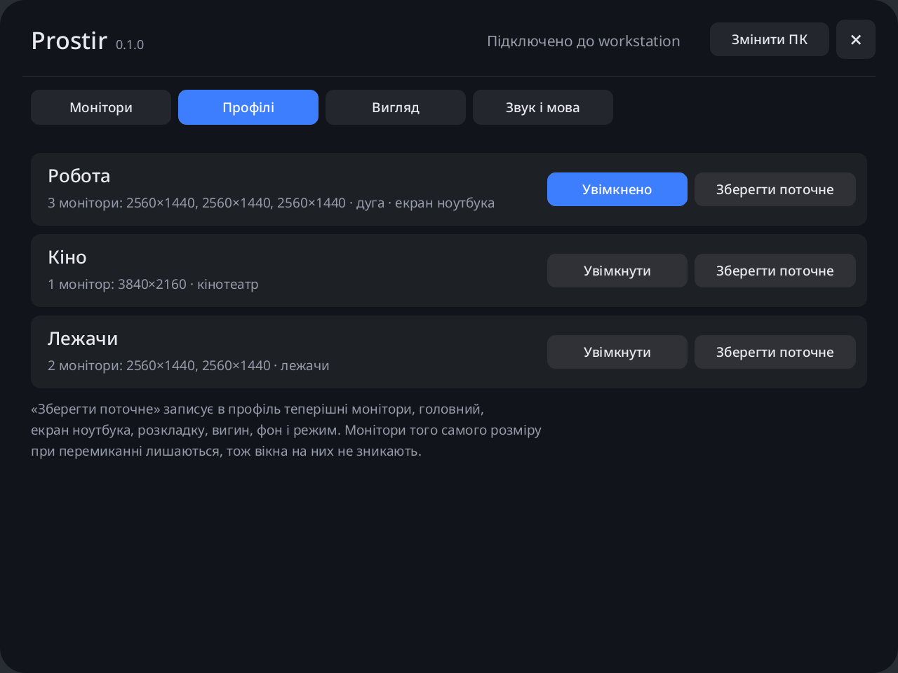
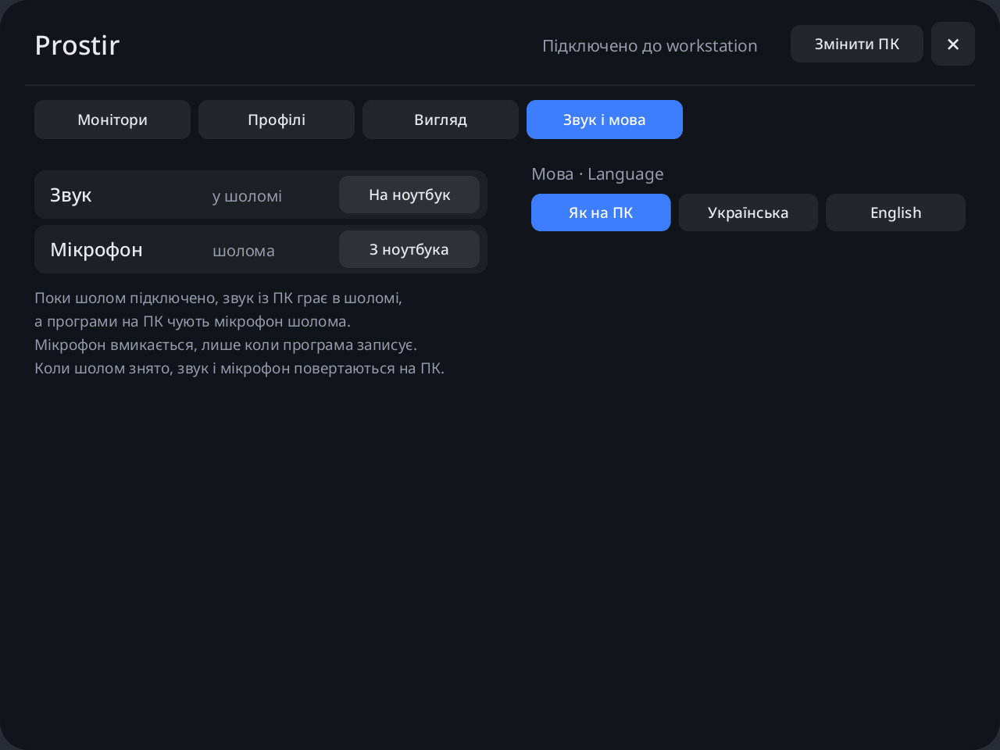
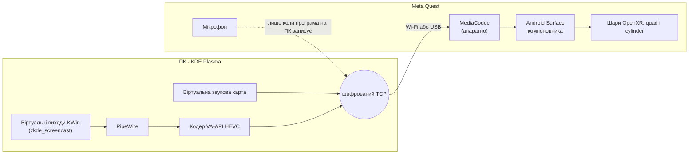

<p align="center">
  
</p>

<h1 align="center">Prostir</h1>

<p align="center">
  Додаткові монітори KDE Plasma навколо вас у Meta Quest 3.
</p>

<p align="center">
  <a href="https://github.com/OlexiyOdarchuk/prostir/actions/workflows/ci.yml"></a>
  <a href="https://github.com/OlexiyOdarchuk/prostir/releases"></a>
  <a href="LICENSE"></a>
  
  
</p>

<p align="center">
  <a href="README.md">English</a> ·
  <a href="#що-він-уміє">Що він уміє</a> ·
  <a href="#встановлення">Встановлення</a> ·
  <a href="#користування">Користування</a> ·
  <a href="#безпека">Безпека</a>
</p>

---

Prostir додає ноутбуку чи ПК із KDE Plasma додаткові монітори, які ви бачите в шоломі
Quest. Це справжні виходи KWin, а не картинки вікон: вони є в «Параметри системи →
Дисплей», на них можна переносити й розгортати вікна, туди можна поставити панель
Plasma, а миша переходить з екрана на екран саме там, де вони стикаються перед вами.

Я написав його, бо хотів три великі монітори для ноутбука, не тягаючи їх із собою.
Користуюся щодня: KDE Plasma 6.8 (Wayland), графіка Intel Arc, Quest 3. Це версія 0.1,
тож шорсткості трапляються. Якщо натрапите, відкрийте issue.

<p align="center">
  
</p>
<p align="center"><sub>Знімок із шолома: на правому моніторі параметри дисплея KDE з трьома виходами Prostir.</sub></p>

<table>
  <tr>
    <td></td>
    <td></td>
  </tr>
  <tr>
    <td></td>
    <td></td>
  </tr>
</table>

<p align="center"><sub>Меню в шоломі (відрендерене на ПК через <code>--example panel_preview</code>).</sub></p>

## Що він уміє

Монітори додаються, прибираються й переставляються прямо з шолома: 1080p, 1440p, 4K,
широкий чи портретний, до шести штук. KDE розставляє свої дисплеї в тому ж порядку,
що й у шоломі, тож миша виходить з одного екрана там, де починається наступний.
Монітор посередині головний, на ньому панель Plasma.

Текст чіткий, бо відео потрапляє просто в шари компоновника Quest
(`XR_KHR_android_surface_swapchain`), а не в пласке вікно всередині застосунку. ПК
кодує відеоблоком відеокарти (VA-API HEVC на Intel чи AMD), Quest декодує апаратно.
По Wi-Fi кадр іде від кодера до показу приблизно за 14 мс на моєму обладнанні.

Монітори можна поставити дугою, сіткою, стовпчиком або над головою, щоб дивитися лежачи.
Вони бувають пласкі чи вигнуті, а на дузі стикаються впритул, тож три монітори
виглядають як один широкий екран. Екран самого ноутбука може висіти під головним
монітором без шва, і тоді шолом знімати не треба. Коли кришку закрито, він зникає.

Профілі перемикають усе налаштування одним натиском. Одразу є «Робота» (три монітори
1440p і екран ноутбука), «Кіно» (один 4K-екран, великий і далеко, решта прихована) і
«Лежачи» (два монітори над головою). Будь-який можна перезаписати своїм. Монітори того
самого розміру при перемиканні лишаються, тож вікна на них не стрибають.

У режимі кінотеатру можна вибрати, який монітор стане великим екраном.

Режим фокусу притемнює всі монітори, крім того, де зараз миша.

Звук із ПК грає в шоломі, а мікрофон шолома стає мікрофоном ПК. Записує шолом лише тоді,
коли якась програма на ПК справді слухає.

Коли ви знімаєте шолом, ПК одразу перестає кодувати. Через 10 секунд він прибирає
віртуальні монітори, і вікна, панель, звук та мікрофон повертаються на ноутбук.
Вдягнете шолом знову, і все повернеться.

Фон: чорний, ваша кімната через камери passthrough, одна з чотирьох вбудованих панорам
або своє фото. Руки можна показувати (зручно над клавіатурою), а за бажанням ними й
керувати: щипок натискає, щипок з утриманням перетягує. Коли руки в полі зору, меню
відкривається на відстані витягнутої руки й працює як сенсорний екран. Вікно на
клавіатуру показує справжній стіл крізь прямокутник, який ви кладете на клавіатуру,
на будь-якому фоні.

Шолом і ПК говорять українською або англійською. Шолом бере мову ПК, якщо в меню не
вибрано іншої.

Підключення по Wi-Fi (шолом сам знаходить ПК) або кабелем USB. Усе шифрується, і ПК
нічого не транслює шолому, з яким не сполучений.

<p align="center">
  
</p>

## Вимоги

**ПК**

- KDE Plasma 6 на Wayland. Віртуальні виходи дає KWin.
- PipeWire з `pw-cli` і `pw-loopback` та GStreamer 1.22 або новіший із плагіном `va`
  (gst-plugins-bad) і плагінами PipeWire та PulseAudio.
- Відеокарта з VA-API-кодером HEVC або H.264 (Intel, AMD). Без нього запускайте з
  `--software`, тоді кодує x264 на процесорі.
- `kscreen-doctor`, він іде з Plasma. Необов'язково: `qdbus6` для однакових шпалер,
  `adb` для USB, `kdialog` або `zenity` для віконця сполучення.

| Дистрибутив | Пакети |
|---|---|
| Arch | `gstreamer gst-plugins-good gst-plugins-bad gst-plugin-pipewire` + `intel-media-driver` (Intel) або `libva-mesa-driver` (AMD) |
| Fedora | `gstreamer1 gstreamer1-plugins-good gstreamer1-plugins-bad-free pipewire-gstreamer` + драйвер VA |
| Debian/Ubuntu | `gstreamer1.0-plugins-good gstreamer1.0-plugins-bad gstreamer1.0-pipewire` + драйвер VA |

**Шолом**

- Meta Quest 3 або 3S. Quest 2 і Pro мають працювати, але я їх не перевіряв.
- Режим розробника, щоб поставити застосунок через `adb`. Вмикається в застосунку Meta
  Horizon на телефоні: Пристрої → Налаштування шолома → Режим розробника.

## Встановлення

### З релізу

1. Завантажте `prostir-<версія>-x86_64-linux.tar.gz` і `prostir-<версія>.apk` з
   [релізів](../../releases).
2. На ПК:
   ```sh
   tar xf prostir-*-x86_64-linux.tar.gz && cd prostir-*/
   ./install.sh             # у ~/.local, без root; --autostart запускає разом із Plasma
   ```
3. На шолом, підключений кабелем USB:
   ```sh
   adb install prostir-*.apk
   ```

### Із сирців

```sh
# ПК
cargo build --release -p prostir-host
./scripts/install.sh

# Quest: потрібні Android SDK з NDK і build-tools та ціль Rust
rustup target add aarch64-linux-android
./scripts/build-apk.sh --install   # збирає build/prostir.apk і ставить через adb
```

## Користування

1. Запустіть Prostir на ПК з меню застосунків або командою `prostir`. У треї з'явиться
   іконка.
2. У шоломі відкрийте Prostir: Бібліотека → Невідомі джерела.
3. Шолом шукає ПК спершу на кабелі USB, потім у Wi-Fi. Якщо знайде кілька ПК, оберіть
   потрібний у меню або введіть IP на клавіатурі.
4. Уперше їх треба сполучити. Шолом покаже 6-значний код, введіть його у віконці на ПК.
   Кнопка під кодом міняє сторони, якщо зручніше вводити код ПК у шоломі.
5. Монітори з'являться перед вами. Натисніть A, щоб вирівняти їх.

Якщо з'єднання обірвалося, монітори 30 секунд чекають у KDE (`--linger`), чи шолом
повернеться, і лише потім вікна переїжджають на ноутбук.

### Керування

| | Контролер | Руки (меню → Вигляд → Руки → І керувати) |
|---|---|---|
| Відкрити меню | ☰ або X на лівому контролері, або кругла кнопка ☰ під головним монітором | щипок по кнопці ☰ |
| Натиснути кнопку в меню | курок | торкнутися пальцем або щипок здалеку |
| Перенести меню | тримати grip і наводити | торкнутися пальцем порожнього місця й тягнути |
| Клік на моніторі | курок | щипок |
| Перенести монітор чи меню | тримати grip і наводити | щипок і тримати приблизно 0,3 с |
| Ближче чи далі | стік вгору чи вниз, поки тримаєте | відсунути чи наблизити руку |
| Більше чи менше | стік вліво чи вправо, поки тримаєте, або взяти обома контролерами й розвести чи звести | взяти обома руками й розвести чи звести |
| Вирівняти монітори | A | меню → Монітори → Розкладка |
| Поставити все перед собою | меню → Монітори → Поставити все перед собою | так само |

Коли руки в полі зору, меню відкривається на відстані витягнутої руки, щоб його можна
було торкатися. Крапка показує, де палець; щоб натиснути наступну кнопку, відведіть
палець.

### Меню

**Монітори.** Додати монітор (1920×1080, 2560×1440, 3840×2160, 3440×1440 або
1440×2560), прибрати, зробити головним, посунути вліво чи вправо в ряду, показати чи
сховати екран ноутбука. Нижче: розкладка, вигин і режим «Робочий стіл» чи «Кінотеатр».

**Профілі.** Перемкнутися на профіль або зберегти в нього поточне налаштування.

**Вигляд.** Фон, руки й режим фокусу. Для свого фону скопіюйте еквідистантну панораму
`background.jpg` або `background.png` у `/sdcard/Android/data/dev.prostir.client/files/`
на шоломі.

**Звук і мова.** Де грає звук ПК, який мікрофон використовує ПК, мова інтерфейсу.

### Трей на ПК

Трей показує, чи підключено шолом і скільки моніторів. Звідти можна змінити якість
відео (15, 30 або 50 Мбіт/с на монітор, діє одразу), увімкнути чіткіший текст
(повільніший режим кодера: дрібний текст чіткіший за того ж бітрейту, а кадр
кодується приблизно на 2 мс довше), запуск разом із системою, забути сполучені шоломи
й вийти.

### Командний рядок

```
prostir [--monitor WxH[@scale]]... [--codec h265|h264] [--bitrate MBPS] [--software]
        [--keep-primary] [--linger SECONDS] [--port PORT] [--no-discovery] [--no-adb]
```

Без `--monitor` Prostir повертає монітори з минулого сеансу. Вони записані в
`~/.config/prostir/monitors.txt`.

## Обмеження

- Лише KDE Plasma 6 на Wayland. Віртуальні монітори дає протокол трансляції KWin, тож
  GNOME, інші компоновники й сеанси X11 не підтримуються.
- Апаратне кодування потребує VA-API, тобто графіки Intel або AMD. Карти NVIDIA
  кодування через VA-API не мають; там працює `--software`, але кодує процесор.
- Перевірено на Quest 3. Quest 3S має поводитися так само; Quest 2 і Pro не перевірялися.
- Застосунку немає в Meta Horizon Store: його ставлять у режимі розробника через `adb`,
  і Quest показує його в «Невідомих джерелах» під назвою пакета `dev.prostir.client`.
- Один шолом на ПК водночас.

## Продуктивність і батарея

Заміри на моєму ноутбуці з трьома моніторами 2560×1440 і екраном ноутбука в шоломі:

- ПК використовує близько 2 % одного ядра і 250 МБ пам'яті. Кодує відеоблок
  відеокарти, і лише тоді, коли екран змінюється.
- У мережі кожен монітор бере до вибраного бітрейту, поки картинка змінюється, і майже
  нічого, коли вона стоїть. Звук додає 1,5 Мбіт/с.
- У шоломі кожен монітор займає один апаратний декодер (простоює на нерухомій
  картинці) і один шар компоновника щокадру. Найбільше заощаджують менша кількість чи
  розмір моніторів, чорний фон і сховані руки. Фон «Кімната» тримає камери passthrough
  увімкненими.

## Безпека

Кожне з'єднання починається з рукостискання Noise `XX` (Curve25519, ChaCha20-Poly1305,
BLAKE2s). Після нього картинка, звук і мікрофон шифруються й автентифікуються.

Шолом і ПК сполучаються один раз. Доти ПК не створює моніторів і нічого не надсилає.
6-значний код проходить через SPAKE2, тож той, хто записав трафік, не підбере його
офлайн, а підтвердження прив'язане до рукостискання саме цього з'єднання, і це зупиняє
«людину посередині».

ПК зберігає ключі сполучених шоломів у `~/.config/prostir/paired_headsets`; пункт трею
«Забути сполучені шоломи» очищає цей список. Шолом зберігає свої ключі всередині
застосунку.

Офіційні збірки рахують, на скількох ПК працює Prostir: раз на день, коли
підключається шолом, ПК надсилає один запит на GoatCounter лише з датою (а вперше ще
`/install`). Жодного ідентифікатора, імені ПК чи налаштувань у ньому немає. Вимкнути
можна в треї («Рахувати цей ПК серед користувачів») або змінною `PROSTIR_NO_COUNT=1`;
збірки з вихідного коду не рахують ніколи. Див. [політику
конфіденційності](https://prostir.ishawyha.dev/uk/privacy.html).

Порти: TCP 47830 для потоку і UDP 47831 для пошуку. Маяк пошуку містить лише ім'я ПК.

## Якщо щось не так

- Лог шолома: `adb logcat -s prostir`.
- Лог ПК: запустіть `prostir` у терміналі. `RUST_LOG=debug prostir` додає конвеєр
  GStreamer і час кодування.
- Шолом не знаходить ПК по Wi-Fi: обидва мають бути в одній мережі, і мережа не повинна
  ізолювати клієнтів (гостьові часто ізолюють). Введіть IP ПК на клавіатурі або
  підключіть кабель.
- Знімок на Quest вийшов чорним: деякі режими знімка не беруть шари компоновника, якими
  малює Prostir. Змініть формат знімка в налаштуваннях камери Quest.

## Як це працює



Код поділено на три крейти Rust:

```
proto/    протокол і шифрування, бібліотека для двох інших
host/     програма для ПК: віртуальні виходи, кодери, звук, трей, пошук
client/   застосунок для Quest: цикл OpenXR (app.rs), меню (ui.rs), розкладки (layout.rs), …
scripts/  build-apk.sh, install.sh, package-release.sh
docs/     картинки для цього README
```

Крім трансляції, ПК розставляє виходи в KDE через `kscreen-doctor`, копіює шпалери на
всі монітори через скриптовий API Plasma, транслює екран ноутбука через `stream_output`
і питає KWin, на якому виході миша, для режиму фокусу. Застосунок для Quest написано
на Rust поверх OpenXR; монітори малює компоновник, а сам застосунок рендерить лише руки.

`cargo test` запускає тести протоколу, розкладок, профілів і меню на ПК.
`cargo run -p prostir-client --example panel_preview -- menu.png` рендерить меню шолома
в PNG (`TAB=profiles|look|sound`, `LANG_UI=en`), а `--example sky_preview -- DIR`
рендерить панорами. `cargo run -p prostir-host --bin prostir-probe -- [HOST:PORT]
[SECONDS] [DIR]` підключається як шолом, сполучається і зберігає отримані відео й звук,
щоб перевірити ПК без шолома.

## Схожі проєкти

- [qwayland](https://github.com/jboero/qwayland): та сама ідея з 2D-панелями Horizon OS
  і кодуванням на NVIDIA.
- [WiVRn](https://github.com/WiVRn/WiVRn) разом із [wlx-overlay-s](https://github.com/galister/wlx-overlay-s):
  загальний OpenXR-стрімінг з оверлеями робочого столу.
- [Breezy Desktop](https://github.com/wheaney/breezy-desktop): віртуальні дисплеї для
  AR-окулярів на KDE і GNOME.
- Immersed: пропрієтарний, працює на кількох платформах.

## Ліцензія

[GPL-3.0-or-later](LICENSE) з [додатковим дозволом](LICENSE-EXCEPTION.md) лінкуватися з
Meta Platform SDK (потрібен лише для збірки в Horizon Store). Вбудований шрифт Noto Sans
поширюється під
[SIL Open Font License 1.1](client/assets/OFL-NotoSans.txt).

Meta і Meta Quest є торговими марками Meta Platforms, Inc. KDE і Plasma є торговими
марками KDE e.V. Prostir є незалежним проєктом, не пов'язаним із ними й не схваленим
ними.
